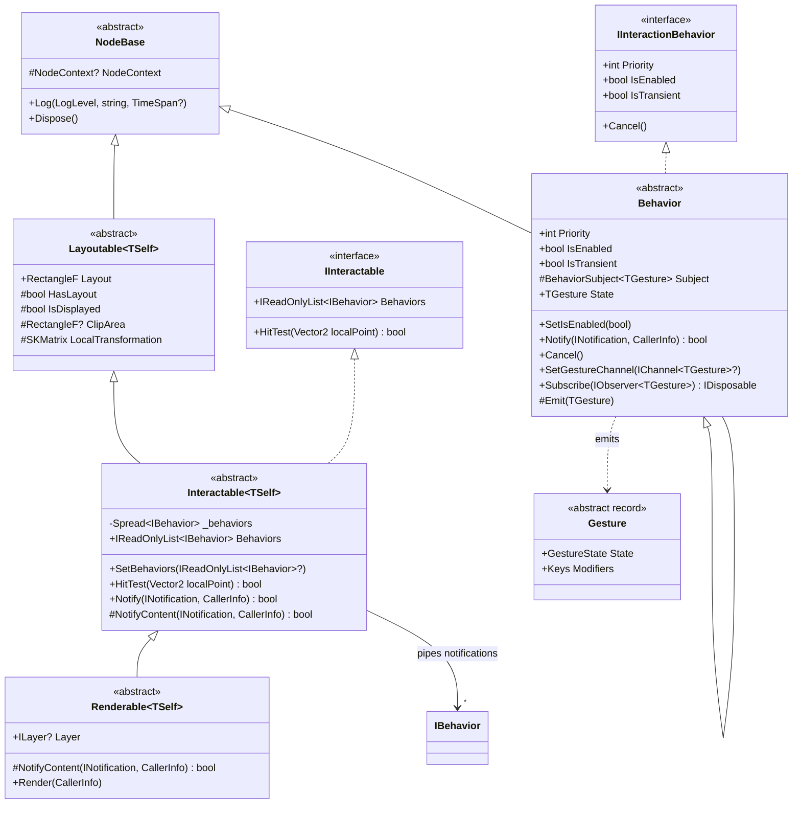

# Interaction Pipeline Architecture (`VL.Fu.Core.Interaction`)

> Historical draft, not an implementation-ready specification. The examples
> below contain known coordinate-space, arbitration, capture, output-lifecycle,
> and cancellation defects. See the [architecture review](./review-interaction-architecture.md)
> and the [current functional-pipeline draft](./proposal-interaction-functional-pipeline.md).
> The examples are retained for context, not as templates to copy unchanged.

This document specifies the production architecture and exact C# design for `VL.Fu`'s interaction pipeline, synthesizing the best patterns from `VL.Core.Skia`, `VL.LidarToolkit.Calibrator`, `VL.Hronomapper.Canvas`, and `VL.Fu5`.

---

## 1. Architectural Principles

1. **Zero-Service, Tree-Native `Notify`:**
   * Every `FuNode` is self-sufficient (`Interactable<TSelf> : Layoutable<TSelf>, IInteractable`). There is no `FuRoot` DI container or background `Scheduler` thread.
   * Notifications flow synchronously through `IBehavior.Notify(INotification notification, CallerInfo caller)` in **reverse paint order** (topmost child first, then inner `Layer`, then self `Behaviors`), mirroring `Renderable<TSelf>.Render` in reverse.
2. **Dual-Space Coordinate Integrity:**
   * **Local Node Space `(0, 0, Layout.Width, Layout.Height)`:** Used for hit testing, `ClipArea` checks, hover coordinates, and wrapping `INotificationWithPosition` via `LocalSpaceNotificationSender` so `notification.PositionInWorldSpace` is always in local coordinates.
   * **Frozen Parent/Caller Space on Capture (`_captureInverse`):** When a drag gesture starts, it freezes the inverse of the parent's `CallerInfo.Transformation` (from *Calibrator*), so a behavior that moves its own node's `Transformation` or `Layout` never suffers from coordinate feedback jitter.
3. **`Possible` → `Started` Disambiguation + Continue-and-`Cancel()`:**
   * On `MouseDown` / `TouchDown`, gestures like `Click` and `Drag` enter `GestureState.Possible` and **return `false`** (do not consume yet).
   * Once a behavior claims an event (`returns true`, e.g., `Drag` crosses its movement `Threshold` and enters `Started`, or `Click` completes on `MouseUp`), the dispatch loop **does not break**—it continues iterating lower-priority behaviors and calls `Cancel()` on them (from *Hronomapper*).
   * Passive behaviors (`IsTransient == true`, such as `Hoverable`) observe notifications without consuming them and are not cancelled when a sibling `Click` or `Drag` activates.
4. **Triple Output Ergonomics (`State` Property + `IObservable<T>` + `IChannel<T>` Sink):**
   * `Behavior<TGesture> : Behavior, IObservable<TGesture>` exposes:
     1. `[Fragment] public TGesture State => _state;` for direct mainloop polling.
     2. `IObservable<TGesture>` (backed by `BehaviorSubject<TGesture>`) for reactive operators (`ForEach`, `HoldLatest`, etc.).
     3. Optional `IChannel<T>` sinks (via `ChannelProperty<T>` / `SetChannel`) that automatically call `Cancel()` if the channel reference is swapped mid-gesture.

---

## 2. Complete Class Diagram



---

## 3. Exact Code Specifications

### 3.1 `LocalSpaceNotificationSender.cs` — Local Coordinate Space Mapping

In `VL.Skia`, `NotificationWithPosition.PositionInWorldSpace` queries `((IWorldSpace2d)notification.Sender).MapFromPixels(notification)`. By wrapping the notification at each `Interactable<TSelf>`, any downstream `Behavior` or inner `ILayer` reading `PositionInWorldSpace` receives coordinates in `(0, 0, Layout.Width, Layout.Height)`.

```csharp
using SkiaSharp;
using Stride.Core.Mathematics;
using VL.Lib.IO.Notifications;
using VL.Lib.Mathematics;
using VL.Skia;

namespace VL.Fu.Core.Interaction
{
    /// <summary>
    /// Maps <see cref="NotificationWithPosition.PositionInWorldSpace"/> from window pixels
    /// into a node's local space (0, 0, Layout.Width, Layout.Height) using the inverse of its
    /// accumulated <see cref="CallerInfo.Transformation"/>.
    /// </summary>
    internal sealed class LocalSpaceNotificationSender : IWorldSpace2d, IProjectionSpace
    {
        private readonly SKMatrix _invTransformation;
        private readonly INotification _originalNotification;
        private readonly SKRect _boundsInPixels;

        public LocalSpaceNotificationSender(
            SKMatrix invTransformation,
            INotification originalNotification,
            SKRect boundsInPixels
        )
        {
            _invTransformation = invTransformation;
            _originalNotification = originalNotification;
            _boundsInPixels = boundsInPixels;
        }

        public Vector2 MapFromPixels(INotificationWithPosition notification)
        {
            var source = _originalNotification as INotificationWithPosition ?? notification;
            var mapped = _invTransformation.MapPoint(source.Position.X, source.Position.Y);
            return new Vector2(mapped.X, mapped.Y);
        }

        public void MapFromPixels(
            INotificationWithPosition notification,
            out Vector2 inNormalizedProjection,
            out Vector2 inProjection
        )
        {
            var pos = new Vector2(
                notification.Position.X - _boundsInPixels.Left,
                notification.Position.Y - _boundsInPixels.Top
            );
            SpaceHelpers.DoMapFromPixels(
                pos,
                new Vector2(_boundsInPixels.Width, _boundsInPixels.Height),
                out inNormalizedProjection,
                out inProjection
            );
        }
    }

    internal static class NotificationSpaceExtensions
    {
        public static bool TryGetWorldPosition(this INotification notification, out Vector2 position)
        {
            if (notification is NotificationWithPosition np)
            {
                position = np.PositionInWorldSpace;
                return float.IsFinite(position.X) && float.IsFinite(position.Y);
            }

            if (notification is INotificationWithPosition pos)
            {
                position = pos.Position;
                return float.IsFinite(position.X) && float.IsFinite(position.Y);
            }

            position = default;
            return false;
        }

        public static Vector2 MapPoint(in SKMatrix matrix, Vector2 point)
        {
            var p = matrix.MapPoint(point.X, point.Y);
            return new Vector2(p.X, p.Y);
        }
    }
}
```

---

### 3.2 `Gesture.cs` — `GestureState` & Immutable Gesture Records

`Gesture` records represent the strongly-typed payload emitted by `Behavior<TGesture>` to both `IObservable<TGesture>` and `IChannel<TGesture>`.

```csharp
using Stride.Core.Mathematics;
using VL.Lib.IO;
using VL.Lib.IO.Notifications;

namespace VL.Fu.Core.Interaction
{
    public enum GestureState
    {
        /// <summary>Default inactive state.</summary>
        Idle,

        /// <summary>Pointer/key pressed inside bounds; waiting for threshold or release.</summary>
        Possible,

        /// <summary>Gesture recognized and started on this notification.</summary>
        Started,

        /// <summary>Gesture is ongoing and updated its parameters (e.g. drag move, pinch).</summary>
        Updated,

        /// <summary>Gesture finished normally (e.g. click released inside, drag dropped).</summary>
        Completed,

        /// <summary>Gesture was interrupted (lost focus, disabled, detached, or preempted).</summary>
        Canceled,
    }

    public static class GestureStateExtensions
    {
        public static bool IsActive(this GestureState state) =>
            state is GestureState.Started or GestureState.Updated;

        public static bool IsPossible(this GestureState state) =>
            state == GestureState.Possible;

        public static bool IsIdle(this GestureState state) =>
            state is GestureState.Idle or GestureState.Completed or GestureState.Canceled;

        public static bool ShouldCancel(this GestureState state) =>
            state is GestureState.Possible or GestureState.Started or GestureState.Updated;
    }

    public abstract record Gesture
    {
        public GestureState State { get; init; } = GestureState.Idle;
        public Keys Modifiers { get; init; } = Keys.None;
    }

    /// <summary>
    /// Base record for pointer-driven gestures (Mouse + Touch).
    /// </summary>
    public abstract record PointerGesture : Gesture
    {
        /// <summary>-1 for Mouse, or TouchNotification.Id for touch points.</summary>
        public int PointerId { get; init; } = -1;

        /// <summary>Position in the owning FuNode's local space (0, 0, Width, Height).</summary>
        public Vector2 LocalPosition { get; init; }

        /// <summary>Position in window pixel space.</summary>
        public Vector2 ScreenPosition { get; init; }

        public MouseButtons Buttons { get; init; } = MouseButtons.None;
    }

    public sealed record HoverGesture : PointerGesture
    {
        public static readonly HoverGesture Default = new();
        public bool IsHovered => State.IsActive();
    }

    public sealed record ClickGesture : PointerGesture
    {
        public static readonly ClickGesture Default = new();
        public int ClickCount { get; init; } = 1;
        public bool IsPressed => State is GestureState.Possible or GestureState.Started or GestureState.Updated;
        public bool IsClicked => State == GestureState.Completed;
    }

    public sealed record DragGesture : PointerGesture
    {
        public static readonly DragGesture Default = new();

        /// <summary>Start position in the reference space captured at press time.</summary>
        public Vector2 StartPosition { get; init; }

        /// <summary>Previous position in the reference space.</summary>
        public Vector2 PreviousPosition { get; init; }

        /// <summary>Current position in the reference space.</summary>
        public Vector2 CurrentPosition { get; init; }

        /// <summary>Frame-to-frame step delta in the reference space.</summary>
        public Vector2 Delta => CurrentPosition - PreviousPosition;

        /// <summary>Total displacement since drag start in the reference space.</summary>
        public Vector2 TotalOffset => CurrentPosition - StartPosition;

        public bool IsDragging => State.IsActive();
    }

    public sealed record WheelGesture : PointerGesture
    {
        public static readonly WheelGesture Default = new();
        public Vector2 WheelDelta { get; init; }
    }

    public sealed record PinchGesture : Gesture
    {
        public static readonly PinchGesture Default = new();
        public Vector2 Center { get; init; }
        public Vector2 PanDelta { get; init; }
        public float ScaleRatio { get; init; } = 1f;
        public bool IsPinching => State.IsActive();
    }

    public sealed record KeyGesture : Gesture
    {
        public static readonly KeyGesture Default = new();
        public Keys KeyCode { get; init; } = Keys.None;
        public char KeyChar { get; init; }
        public bool IsKeyDown => State.IsActive();
    }
}
```

---

### 3.3 `Behavior.cs` — `IInteractionBehavior`, `Behavior`, and `Behavior<TGesture>`

```csharp
using System.Reactive.Subjects;
using Stride.Core.Mathematics;
using VL.Core;
using VL.Core.Import;
using VL.Fu.Core.Base;
using VL.Fu.Core.Constants;
using VL.Lib.IO.Notifications;
using VL.Lib.Reactive;
using VL.Model;
using VL.Skia;

namespace VL.Fu.Core.Interaction
{
    public static class GesturePriority
    {
        public const int Low = -100;
        public const int Default = 0;
        public const int Hover = 10;
        public const int Click = 50;
        public const int Drag = 100;
        public const int High = 200;
    }

    public interface IInteractionBehavior : IBehavior, IDisposable
    {
        int Priority { get; }
        bool IsEnabled { get; }

        /// <summary>
        /// Transient behaviors (e.g. Hover) run in parallel: they never consume notifications
        /// and are not cancelled when a non-transient behavior on the same node claims an event.
        /// </summary>
        bool IsTransient { get; }

        /// <summary>
        /// True while the behavior is actively tracking a pointer/gesture (e.g. Possible or Active drag/press)
        /// and should continue receiving move/up events even when the cursor leaves the node's bounds.
        /// </summary>
        bool HasCapture { get; }

        /// <summary>
        /// Evaluates a notification in the context of an owning <see cref="IInteractable"/> node.
        /// </summary>
        bool Notify(INotification notification, CallerInfo caller, IInteractable? owner, bool isInsideNode);

        /// <summary>
        /// Resets any in-flight gesture state immediately (called on disable, detach, focus loss, or preemption).
        /// </summary>
        void Cancel();
    }

    [ProcessNode(FragmentSelection = FragmentSelection.Explicit)]
    public abstract class Behavior : NodeBase, IInteractionBehavior
    {
        private bool _isEnabled = true;
        private int _priority;

        protected Behavior(
            [Pin(Visibility = PinVisibility.Hidden)] NodeContext nodeContext,
            int defaultPriority = GesturePriority.Default
        )
            : base(nodeContext)
        {
            _priority = defaultPriority;
        }

        public int Priority => _priority;

        public virtual void SetPriority(int priority)
        {
            _priority = priority;
        }

        public bool IsEnabled => _isEnabled;

        [Fragment(Order = PinOrder.Enabled)]
        public void SetIsEnabled(bool isEnabled = true)
        {
            if (_isEnabled == isEnabled)
                return;

            _isEnabled = isEnabled;
            if (!_isEnabled)
                Cancel();

            OnEnabledChanged(isEnabled);
        }

        public virtual bool IsTransient => false;

        public virtual bool HasCapture => false;

        protected virtual void OnEnabledChanged(bool isEnabled) { }

        /// <summary>
        /// Entry point when used standalone as a standard <see cref="VL.Skia.IBehavior"/> outside a FuNode.
        /// </summary>
        public bool Notify(INotification notification, CallerInfo caller) =>
            Notify(notification, caller, owner: null, isInsideNode: true);

        public bool Notify(
            INotification notification,
            CallerInfo caller,
            IInteractable? owner,
            bool isInsideNode
        )
        {
            if (notification is MouseLostNotification or LostFocusNotification or KeyboardLostNotification)
            {
                Cancel();
                return false;
            }

            if (!_isEnabled)
                return false;

            return OnNotify(notification, caller, owner, isInsideNode);
        }

        protected abstract bool OnNotify(
            INotification notification,
            CallerInfo caller,
            IInteractable? owner,
            bool isInsideNode
        );

        public abstract void Cancel();

        protected override void Dispose(bool disposing)
        {
            if (disposing)
                Cancel();

            base.Dispose(disposing);
        }
    }

    /// <summary>
    /// Generic base class for behaviors that produce a <typeparamref name="TGesture"/> state,
    /// exposing it as a property, an <see cref="IObservable{TGesture}"/>, and an optional <see cref="IChannel{TGesture}"/> sink.
    /// </summary>
    [ProcessNode(FragmentSelection = FragmentSelection.Explicit)]
    public abstract class Behavior<TGesture> : Behavior, IObservable<TGesture>
        where TGesture : Gesture
    {
        protected readonly BehaviorSubject<TGesture> Subject;
        private IChannel<TGesture>? _gestureChannel;

        protected Behavior(
            [Pin(Visibility = PinVisibility.Hidden)] NodeContext nodeContext,
            TGesture initialState,
            int defaultPriority = GesturePriority.Default
        )
            : base(nodeContext, defaultPriority)
        {
            Subject = new BehaviorSubject<TGesture>(initialState);
        }

        /// <summary>Latest gesture state for mainloop polling.</summary>
        [Fragment]
        public TGesture State => Subject.Value;

        /// <summary>Optional channel sink that receives every emitted <typeparamref name="TGesture"/>.</summary>
        public void SetGestureChannel(
            [Pin(Visibility = PinVisibility.Optional)] IChannel<TGesture>? channel
        )
        {
            var next = channel.IsValid() ? channel : null;
            if (ReferenceEquals(_gestureChannel, next))
                return;

            Cancel();
            _gestureChannel = next;
        }

        protected void Emit(TGesture nextState)
        {
            if (Subject.IsDisposed)
                return;

            Subject.OnNext(nextState);
            _gestureChannel?.EnsureValue(nextState);
        }

        /// <summary>
        /// Helper to safely swap a bound value channel (cancelling any active gesture first if the reference changed).
        /// </summary>
        protected void ReplaceChannel<T>(ref IChannel<T>? field, IChannel<T>? nextChannel)
        {
            var valid = nextChannel.IsValid() ? nextChannel : null;
            if (ReferenceEquals(field, valid))
                return;

            Cancel();
            field = valid;
        }

        public IDisposable Subscribe(IObserver<TGesture> observer) => Subject.Subscribe(observer);

        protected override void Dispose(bool disposing)
        {
            base.Dispose(disposing);
            if (disposing && !Subject.IsDisposed)
            {
                Subject.OnCompleted();
                Subject.Dispose();
            }
        }
    }
}
```

---

### 3.4 `Interactable.cs` & `Renderable.cs` — Tree-Walk `Notify`, Hit-Testing, Capture & Cancel

```csharp
using SkiaSharp;
using Stride.Core.Mathematics;
using VL.Core;
using VL.Core.Import;
using VL.Fu.Core.Constants;
using VL.Fu.Core.Layout;
using VL.Fu.Core.Tree;
using VL.Lib.Collections;
using VL.Lib.IO.Notifications;
using VL.Model;
using VL.Skia;

namespace VL.Fu.Core.Interaction
{
    public interface IInteractable : ILayoutable, IBehavior
    {
        IReadOnlyList<IBehavior> Behaviors { get; }
        bool HitTest(Vector2 localPoint);
    }

    [ProcessNode(FragmentSelection = FragmentSelection.Explicit)]
    public abstract class Interactable<TSelf> : Layoutable<TSelf>, IInteractable
        where TSelf : class, ITraversable<TSelf>, IInteractable
    {
        private Spread<IBehavior>? _rawBehaviors;
        private Spread<IBehavior> _behaviors = Spread<IBehavior>.Empty;

        public IReadOnlyList<IBehavior> Behaviors => _behaviors;

        protected Interactable([Pin(Visibility = PinVisibility.Hidden)] NodeContext nodeContext)
            : base(nodeContext) { }

        /// <summary>
        /// Plugs behaviors into this node. Unconnected null slots and duplicates are ignored;
        /// any behavior that was removed has <see cref="IInteractionBehavior.Cancel"/> called immediately.
        /// </summary>
        [Fragment(Order = PinOrder.Behavior)]
        public void SetBehaviors(
            [Pin(Visibility = PinVisibility.Optional)] IReadOnlyList<IBehavior>? behaviors
        )
        {
            if (ReferenceEquals(_rawBehaviors, behaviors))
                return;

            var next = behaviors is null || behaviors.Count == 0
                ? Spread<IBehavior>.Empty
                : behaviors
                    .Where(b => b is not null)
                    .Distinct(ReferenceEqualityComparer.Instance)
                    .OrderByDescending(b => (b as IInteractionBehavior)?.Priority ?? 0)
                    .ToSpread();

            if (!_behaviors.SequenceEqual(next, ReferenceEqualityComparer.Instance))
            {
                foreach (var old in _behaviors)
                {
                    if (!next.Contains(old, ReferenceEqualityComparer.Instance)
                        && old is IInteractionBehavior removed)
                    {
                        removed.Cancel();
                    }
                }

                _behaviors = next;
            }

            _rawBehaviors = behaviors as Spread<IBehavior>;
        }

        /// <summary>
        /// Checks whether <paramref name="localPoint"/> (in this node's own space, with (0, 0) at top-left)
        /// falls inside its layout box.
        /// </summary>
        public virtual bool HitTest(Vector2 localPoint)
        {
            if (!HasLayout || !IsDisplayed)
                return false;

            var layout = Layout;
            return localPoint.X >= 0f
                && localPoint.Y >= 0f
                && localPoint.X <= layout.Width
                && localPoint.Y <= layout.Height;
        }

        /// <summary>
        /// Hook for <see cref="Rendering.Renderable{TSelf}"/> to forward notifications to its inner <see cref="ILayer"/>.
        /// </summary>
        protected virtual bool NotifyContent(INotification notification, CallerInfo innerCaller) =>
            false;

        /// <summary>
        /// Routes <paramref name="notification"/> front-to-back (reverse of <c>Render</c>):
        /// children in reverse order first, then inner layer content, then this node's own behaviors.
        /// </summary>
        public bool Notify(INotification notification, CallerInfo caller)
        {
            if (!HasLayout || !IsDisplayed)
                return false;

            var local = LocalTransformation;
            var innerCaller = caller.WithTransformation(caller.Transformation.PreConcat(local));

            if (!innerCaller.Transformation.TryInvert(out var invTransformation))
                return false;

            var layout = Layout;
            var boundsInPixels = innerCaller.Transformation.MapRect(
                SKRect.Create(0, 0, layout.Width, layout.Height)
            );
            var localNotification = notification.WithSender(
                new LocalSpaceNotificationSender(invTransformation, notification, boundsInPixels)
            );

            var hasPosition = localNotification.TryGetWorldPosition(out var localPos);

            // 1. Children (reverse draw order: topmost child first).
            // Guarded by ClipArea unless a descendant behavior currently holds pointer capture.
            var children = Children;
            if (children.Count > 0)
            {
                var insideClip =
                    !hasPosition
                    || ClipArea is not { } clip
                    || (clip.Width > 0 && clip.Height > 0 && clip.Contains(localPos));

                for (var i = children.Count - 1; i >= 0; i--)
                {
                    var child = children[i];
                    if (!insideClip && !HasCapturedDescendant(child))
                        continue;

                    if (child.Notify(localNotification, innerCaller))
                    {
                        // A child on top consumed the event -> cancel non-transient behaviors on this node
                        // and on earlier siblings so pending Possible states don't linger.
                        CancelSiblingAndSelfBehaviors(children, belowIndex: i - 1);
                        return true;
                    }
                }
            }

            // 2. Inner Skia Layer (in Renderable<TSelf>)
            if (NotifyContent(localNotification, innerCaller))
            {
                CancelSelfBehaviors(includeTransient: false);
                return true;
            }

            // 3. Self Behaviors (sorted by Priority descending)
            if (_behaviors.Count == 0)
                return false;

            var isInside = !hasPosition || HitTest(localPos);
            var isHandled = false;

            foreach (var b in _behaviors)
            {
                if (b is IInteractionBehavior ib)
                {
                    if (!isHandled || ib.IsTransient)
                    {
                        if (ib.Notify(localNotification, innerCaller, this, isInside) && !ib.IsTransient)
                        {
                            isHandled = true;
                        }
                    }
                    else
                    {
                        // Higher-priority behavior claimed the event -> cancel lower-priority ones!
                        ib.Cancel();
                    }
                }
                else if (!isHandled && isInside)
                {
                    if (b.Notify(localNotification, innerCaller))
                        isHandled = true;
                }
            }

            return isHandled;
        }

        private static bool HasCapturedDescendant(TSelf node)
        {
            foreach (var b in node.Behaviors)
            {
                if (b is IInteractionBehavior { HasCapture: true })
                    return true;
            }

            var children = node.Children;
            for (var i = 0; i < children.Count; i++)
            {
                if (HasCapturedDescendant(children[i]))
                    return true;
            }

            return false;
        }

        private void CancelSiblingAndSelfBehaviors(IReadOnlyList<TSelf> children, int belowIndex)
        {
            for (var j = belowIndex; j >= 0; j--)
            {
                foreach (var b in children[j].Behaviors)
                {
                    if (b is IInteractionBehavior { IsTransient: false } ib)
                        ib.Cancel();
                }
            }

            CancelSelfBehaviors(includeTransient: false);
        }

        private void CancelSelfBehaviors(bool includeTransient)
        {
            foreach (var b in _behaviors)
            {
                if (b is IInteractionBehavior ib && (includeTransient || !ib.IsTransient))
                    ib.Cancel();
            }
        }

        protected override void Dispose(bool disposing)
        {
            if (disposing)
                CancelSelfBehaviors(includeTransient: true);

            base.Dispose(disposing);
        }
    }
}
```

And in `Renderable<TSelf>`:
```csharp
protected override bool NotifyContent(INotification notification, CallerInfo innerCaller) =>
    _layer?.Notify(notification, innerCaller) ?? false;
```

---

## 4. Concrete Behavior Examples (Pointer, Mouse, Key)

### 4.1 `Hoverable` (`IsTransient = true` — Passive Pointer / Mouse Hover)

* Never blocks clicks or drags (`IsTransient => true`).
* Automatically resets `IsHovered = false` when the pointer moves outside `LocalBounds`, when a child covers it, or when `MouseLostNotification` arrives.

```csharp
using VL.Core;
using VL.Core.Import;
using VL.Lib.IO;
using VL.Lib.IO.Notifications;
using VL.Lib.Reactive;
using VL.Model;
using VL.Skia;

namespace VL.Fu.Core.Interaction.Behaviors
{
    [ProcessNode(Name = "Hoverable", HasStateOutput = true, FragmentSelection = FragmentSelection.Explicit)]
    public sealed class Hoverable : Behavior<HoverGesture>
    {
        private IChannel<bool>? _isHoveredChannel;

        [Fragment]
        public Hoverable([Pin(Visibility = PinVisibility.Hidden)] NodeContext nodeContext)
            : base(nodeContext, HoverGesture.Default, GesturePriority.Hover) { }

        public override bool IsTransient => true;

        [Fragment]
        public bool IsHovered => State.IsHovered;

        [Fragment]
        public void SetIsHoveredChannel(
            [Pin(Visibility = PinVisibility.Optional)] IChannel<bool>? isHoveredChannel
        ) => ReplaceChannel(ref _isHoveredChannel, isHoveredChannel);

        protected override bool OnNotify(
            INotification notification,
            CallerInfo caller,
            IInteractable? owner,
            bool isInsideNode
        )
        {
            if (notification is MouseNotification mouse)
            {
                notification.TryGetWorldPosition(out var localPos);
                UpdateHover(
                    isInsideNode && mouse is not MouseLostNotification,
                    pointerId: -1,
                    localPos,
                    mouse.Position,
                    mouse.ModifierKeys
                );
            }
            else if (notification is TouchNotification touch && touch.Primary)
            {
                notification.TryGetWorldPosition(out var localPos);
                var hovered = isInsideNode && touch.Kind != TouchNotificationKind.TouchUp;
                UpdateHover(hovered, touch.Id, localPos, touch.Position, touch.ModifierKeys);
            }

            return false; // Transient: never consumes notifications
        }

        private void UpdateHover(
            bool isHovered,
            int pointerId,
            Stride.Core.Mathematics.Vector2 localPos,
            Stride.Core.Mathematics.Vector2 screenPos,
            Keys modifiers
        )
        {
            var prev = State;
            if (!isHovered)
            {
                if (prev.IsHovered)
                {
                    Emit(
                        prev with
                        {
                            State = GestureState.Completed,
                            LocalPosition = localPos,
                            ScreenPosition = screenPos,
                            Modifiers = modifiers,
                        }
                    );
                    Emit(HoverGesture.Default);
                    _isHoveredChannel?.EnsureValue(false);
                }
                return;
            }

            var nextPhase = prev.IsHovered ? GestureState.Updated : GestureState.Started;
            Emit(
                new HoverGesture
                {
                    State = nextPhase,
                    PointerId = pointerId,
                    LocalPosition = localPos,
                    ScreenPosition = screenPos,
                    Modifiers = modifiers,
                }
            );
            _isHoveredChannel?.EnsureValue(true);
        }

        public override void Cancel()
        {
            if (State.IsHovered)
            {
                Emit(State with { State = GestureState.Canceled });
                Emit(HoverGesture.Default);
                _isHoveredChannel?.EnsureValue(false);
            }
        }
    }
}
```

---

### 4.2 `Clickable` (Unified Mouse + Touch Click with `Possible` State & Movement Threshold)

* Supports both `MouseNotification` (configurable `MouseButtons`, default `Left`) and primary `TouchNotification`.
* Enters `GestureState.Possible` on press (`returns false` so `Draggable` on the same node can also see the press!).
* Cancels if the pointer drags further than `Threshold` before release.
* Completes and consumes `MouseUp` / `TouchUp` (`returns true`) if released inside the node within `Threshold`.

```csharp
using System.Reactive;
using Stride.Core.Mathematics;
using VL.Core;
using VL.Core.Import;
using VL.Lib.IO;
using VL.Lib.IO.Notifications;
using VL.Lib.Reactive;
using VL.Model;
using VL.Skia;

namespace VL.Fu.Core.Interaction.Behaviors
{
    [ProcessNode(Name = "Clickable", HasStateOutput = true, FragmentSelection = FragmentSelection.Explicit)]
    public sealed class Clickable : Behavior<ClickGesture>
    {
        private MouseButtons _buttons = MouseButtons.Left;
        private float _threshold = 6f; // pixels in window space
        private Vector2 _pressScreenPos;

        private IChannel<Unit>? _onClickChannel;
        private IChannel<bool>? _isPressedChannel;

        [Fragment]
        public Clickable([Pin(Visibility = PinVisibility.Hidden)] NodeContext nodeContext)
            : base(nodeContext, ClickGesture.Default, GesturePriority.Click) { }

        public override bool HasCapture => State.State == GestureState.Possible;

        [Fragment]
        public bool IsPressed => State.IsPressed;

        [Fragment]
        public bool IsClicked => State.IsClicked;

        [Fragment]
        public void SetButtons(MouseButtons buttons = MouseButtons.Left) => _buttons = buttons;

        [Fragment]
        public void SetOnClickChannel(
            [Pin(Visibility = PinVisibility.Optional)] IChannel<Unit>? onClickChannel
        ) => ReplaceChannel(ref _onClickChannel, onClickChannel);

        [Fragment]
        public void SetIsPressedChannel(
            [Pin(Visibility = PinVisibility.Optional)] IChannel<bool>? isPressedChannel
        ) => ReplaceChannel(ref _isPressedChannel, isPressedChannel);

        protected override bool OnNotify(
            INotification notification,
            CallerInfo caller,
            IInteractable? owner,
            bool isInsideNode
        )
        {
            // Clear transient Completed state from previous event
            if (State.State == GestureState.Completed)
                Emit(ClickGesture.Default);

            notification.TryGetWorldPosition(out var localPos);

            switch (notification)
            {
                case MouseDownNotification down when down.Buttons.HasFlag(_buttons):
                    if (!State.State.IsIdle())
                        Cancel();

                    if (!isInsideNode)
                        return false;

                    _pressScreenPos = down.Position;
                    Emit(
                        new ClickGesture
                        {
                            State = GestureState.Possible,
                            PointerId = -1,
                            Buttons = down.Buttons,
                            LocalPosition = localPos,
                            ScreenPosition = down.Position,
                            Modifiers = down.ModifierKeys,
                        }
                    );
                    _isPressedChannel?.EnsureValue(true);
                    return false; // Do not consume yet so Draggable can also enter Possible

                case MouseMoveNotification move when State.State == GestureState.Possible && State.PointerId == -1:
                    if ((move.Position - _pressScreenPos).Length() > _threshold)
                        Cancel();
                    return false;

                case MouseUpNotification up when up.Buttons.HasFlag(_buttons) && State.State == GestureState.Possible && State.PointerId == -1:
                    _isPressedChannel?.EnsureValue(false);
                    if (isInsideNode)
                    {
                        Emit(
                            State with
                            {
                                State = GestureState.Completed,
                                LocalPosition = localPos,
                                ScreenPosition = up.Position,
                                Modifiers = up.ModifierKeys,
                            }
                        );
                        _onClickChannel?.OnNext(Unit.Default);
                        return true; // Claim the click!
                    }

                    Cancel();
                    return false;

                case TouchNotification touch when touch.Primary:
                    return HandleTouch(touch, localPos, isInsideNode);

                default:
                    return false;
            }
        }

        private bool HandleTouch(TouchNotification touch, Vector2 localPos, bool isInsideNode)
        {
            switch (touch.Kind)
            {
                case TouchNotificationKind.TouchDown:
                    if (!State.State.IsIdle())
                        Cancel();
                    if (!isInsideNode)
                        return false;

                    _pressScreenPos = touch.Position;
                    Emit(
                        new ClickGesture
                        {
                            State = GestureState.Possible,
                            PointerId = touch.Id,
                            LocalPosition = localPos,
                            ScreenPosition = touch.Position,
                            Modifiers = touch.ModifierKeys,
                        }
                    );
                    _isPressedChannel?.EnsureValue(true);
                    return false;

                case TouchNotificationKind.TouchMove when State.State == GestureState.Possible && State.PointerId == touch.Id:
                    if ((touch.Position - _pressScreenPos).Length() > _threshold)
                        Cancel();
                    return false;

                case TouchNotificationKind.TouchUp when State.State == GestureState.Possible && State.PointerId == touch.Id:
                    _isPressedChannel?.EnsureValue(false);
                    if (isInsideNode)
                    {
                        Emit(
                            State with
                            {
                                State = GestureState.Completed,
                                LocalPosition = localPos,
                                ScreenPosition = touch.Position,
                                Modifiers = touch.ModifierKeys,
                            }
                        );
                        _onClickChannel?.OnNext(Unit.Default);
                        return true;
                    }
                    Cancel();
                    return false;

                default:
                    return false;
            }
        }

        public override void Cancel()
        {
            if (State.State.ShouldCancel())
            {
                _isPressedChannel?.EnsureValue(false);
                Emit(State with { State = GestureState.Canceled });
                Emit(ClickGesture.Default);
            }
        }
    }
}
```

---

### 4.3 `Draggable` (Pointer Capture + Frozen Reference Inverse Matrix + `IChannel<Vector2>` Sink)

* Combines *Hronomapper*'s `Possible` threshold state machine with *Calibrator*'s frozen `_captureInverse` matrix!
* Why `_captureInverse` is frozen at press time:
  * If `Draggable` is driving a node's position (or scroll offset), the node's own `LocalTransformation` changes every frame as it moves.
  * By capturing `parentCaller.Transformation.TryInvert(out _captureInverse)` (or the caller transform *before* the moving node's own offset) at `MouseDown`, `CurrentPosition - StartPosition` is completely immune to self-movement feedback.

```csharp
using SkiaSharp;
using Stride.Core.Mathematics;
using VL.Core;
using VL.Core.Import;
using VL.Lib.IO;
using VL.Lib.IO.Notifications;
using VL.Lib.Reactive;
using VL.Model;
using VL.Skia;

namespace VL.Fu.Core.Interaction.Behaviors
{
    [ProcessNode(Name = "Draggable", HasStateOutput = true, FragmentSelection = FragmentSelection.Explicit)]
    public sealed class Draggable : Behavior<DragGesture>
    {
        private MouseButtons _buttons = MouseButtons.Left;
        private float _threshold = 4f; // pixels in window space

        private SKMatrix _captureInverse = SKMatrix.Identity;
        private Vector2 _pressScreenPos;
        private Vector2 _valueAtStart;

        private IChannel<Vector2>? _valueChannel;
        private IChannel<bool>? _isDraggingChannel;

        [Fragment]
        public Draggable([Pin(Visibility = PinVisibility.Hidden)] NodeContext nodeContext)
            : base(nodeContext, DragGesture.Default, GesturePriority.Drag) { }

        public override bool HasCapture =>
            State.State is GestureState.Possible or GestureState.Started or GestureState.Updated;

        [Fragment]
        public bool IsDragging => State.IsDragging;

        [Fragment]
        public Vector2 Delta => State.Delta;

        [Fragment]
        public Vector2 TotalOffset => State.TotalOffset;

        [Fragment]
        public void SetButtons(MouseButtons buttons = MouseButtons.Left) => _buttons = buttons;

        [Fragment]
        public void SetThreshold(float threshold = 4f) => _threshold = Math.Max(0f, threshold);

        [Fragment]
        public void SetValueChannel(
            [Pin(Visibility = PinVisibility.Optional)] IChannel<Vector2>? valueChannel
        ) => ReplaceChannel(ref _valueChannel, valueChannel);

        [Fragment]
        public void SetIsDraggingChannel(
            [Pin(Visibility = PinVisibility.Optional)] IChannel<bool>? isDraggingChannel
        ) => ReplaceChannel(ref _isDraggingChannel, isDraggingChannel);

        protected override bool OnNotify(
            INotification notification,
            CallerInfo caller,
            IInteractable? owner,
            bool isInsideNode
        )
        {
            if (State.State == GestureState.Completed)
                Emit(DragGesture.Default);

            notification.TryGetWorldPosition(out var localPos);

            switch (notification)
            {
                case MouseDownNotification down when down.Buttons.HasFlag(_buttons):
                    return TryBeginPointer(-1, down.Position, localPos, down.Buttons, down.ModifierKeys, caller, isInsideNode);

                case MouseMoveNotification move when State.PointerId == -1:
                    return TryMovePointer(move.Position, localPos, move.ModifierKeys);

                case MouseUpNotification up when up.Buttons.HasFlag(_buttons) && State.PointerId == -1:
                    return TryEndPointer(up.Position, localPos, up.ModifierKeys);

                case TouchNotification { Primary: true } touch:
                    return touch.Kind switch
                    {
                        TouchNotificationKind.TouchDown => TryBeginPointer(
                            touch.Id,
                            touch.Position,
                            localPos,
                            MouseButtons.Left,
                            touch.ModifierKeys,
                            caller,
                            isInsideNode
                        ),
                        TouchNotificationKind.TouchMove when State.PointerId == touch.Id =>
                            TryMovePointer(touch.Position, localPos, touch.ModifierKeys),
                        TouchNotificationKind.TouchUp when State.PointerId == touch.Id =>
                            TryEndPointer(touch.Position, localPos, touch.ModifierKeys),
                        _ => false,
                    };

                default:
                    return false;
            }
        }

        private bool TryBeginPointer(
            int pointerId,
            Vector2 screenPos,
            Vector2 localPos,
            MouseButtons buttons,
            Keys modifiers,
            CallerInfo caller,
            bool isInsideNode
        )
        {
            if (!State.State.IsIdle())
                Cancel();

            if (!isInsideNode || !caller.Transformation.TryInvert(out _captureInverse))
                return false;

            _pressScreenPos = screenPos;
            _valueAtStart = _valueChannel?.Value ?? Vector2.Zero;
            var startPos = NotificationSpaceExtensions.MapPoint(in _captureInverse, screenPos);

            Emit(
                new DragGesture
                {
                    State = GestureState.Possible,
                    PointerId = pointerId,
                    Buttons = buttons,
                    LocalPosition = localPos,
                    ScreenPosition = screenPos,
                    StartPosition = startPos,
                    PreviousPosition = startPos,
                    CurrentPosition = startPos,
                    Modifiers = modifiers,
                }
            );

            // Return false while Possible so Clickable on the same node also sees the press.
            return false;
        }

        private bool TryMovePointer(Vector2 screenPos, Vector2 localPos, Keys modifiers)
        {
            var current = State;
            if (current.State == GestureState.Possible)
            {
                if ((screenPos - _pressScreenPos).Length() < _threshold)
                    return false;

                var mapped = NotificationSpaceExtensions.MapPoint(in _captureInverse, screenPos);
                var started = current with
                {
                    State = GestureState.Started,
                    LocalPosition = localPos,
                    ScreenPosition = screenPos,
                    PreviousPosition = current.StartPosition,
                    CurrentPosition = mapped,
                    Modifiers = modifiers,
                };

                Emit(started);
                _isDraggingChannel?.EnsureValue(true);
                _valueChannel?.EnsureValue(_valueAtStart + started.TotalOffset);
                return true; // Claim the gesture! Lower-priority Clickable is now Canceled!
            }

            if (current.State.IsActive())
            {
                var mapped = NotificationSpaceExtensions.MapPoint(in _captureInverse, screenPos);
                var updated = current with
                {
                    State = GestureState.Updated,
                    LocalPosition = localPos,
                    ScreenPosition = screenPos,
                    PreviousPosition = current.CurrentPosition,
                    CurrentPosition = mapped,
                    Modifiers = modifiers,
                };

                Emit(updated);
                _valueChannel?.EnsureValue(_valueAtStart + updated.TotalOffset);
                return true;
            }

            return false;
        }

        private bool TryEndPointer(Vector2 screenPos, Vector2 localPos, Keys modifiers)
        {
            var current = State;
            if (current.State.IsActive())
            {
                var mapped = NotificationSpaceExtensions.MapPoint(in _captureInverse, screenPos);
                var completed = current with
                {
                    State = GestureState.Completed,
                    LocalPosition = localPos,
                    ScreenPosition = screenPos,
                    PreviousPosition = current.CurrentPosition,
                    CurrentPosition = mapped,
                    Modifiers = modifiers,
                };

                Emit(completed);
                _valueChannel?.EnsureValue(_valueAtStart + completed.TotalOffset);
                _isDraggingChannel?.EnsureValue(false);
                return true;
            }

            if (current.State == GestureState.Possible)
            {
                // Released before crossing drag threshold -> it was a click, silently return to Idle.
                Emit(DragGesture.Default);
            }

            return false;
        }

        public override void Cancel()
        {
            if (State.State.ShouldCancel())
            {
                _isDraggingChannel?.EnsureValue(false);
                Emit(State with { State = GestureState.Canceled });
                Emit(DragGesture.Default);
            }
        }
    }
}
```

---

### 4.4 `KeyPressable` (Keyboard Notifications)

```csharp
using VL.Core;
using VL.Core.Import;
using VL.Lib.IO;
using VL.Lib.IO.Notifications;
using VL.Lib.Reactive;
using VL.Model;
using VL.Skia;

namespace VL.Fu.Core.Interaction.Behaviors
{
    [ProcessNode(Name = "KeyPressable", HasStateOutput = true, FragmentSelection = FragmentSelection.Explicit)]
    public sealed class KeyPressable : Behavior<KeyGesture>
    {
        private Keys _key = Keys.None;
        private bool _consume;
        private IChannel<bool>? _isKeyDownChannel;

        [Fragment]
        public KeyPressable([Pin(Visibility = PinVisibility.Hidden)] NodeContext nodeContext)
            : base(nodeContext, KeyGesture.Default, GesturePriority.Default) { }

        [Fragment]
        public bool IsKeyDown => State.IsKeyDown;

        [Fragment]
        public void SetKey(Keys key = Keys.None, bool consume = false)
        {
            if (_key != key)
            {
                Cancel();
                _key = key;
            }
            _consume = consume;
        }

        [Fragment]
        public void SetIsKeyDownChannel(
            [Pin(Visibility = PinVisibility.Optional)] IChannel<bool>? isKeyDownChannel
        ) => ReplaceChannel(ref _isKeyDownChannel, isKeyDownChannel);

        protected override bool OnNotify(
            INotification notification,
            CallerInfo caller,
            IInteractable? owner,
            bool isInsideNode
        )
        {
            if (notification is not KeyNotification keyNotif)
                return false;

            switch (keyNotif)
            {
                case KeyDownNotification down when _key == Keys.None || down.KeyCode == _key:
                    if (!State.IsKeyDown || State.KeyCode != down.KeyCode)
                    {
                        Emit(
                            new KeyGesture
                            {
                                State = GestureState.Started,
                                KeyCode = down.KeyCode,
                                Modifiers = down.ModifierKeys,
                            }
                        );
                        _isKeyDownChannel?.EnsureValue(true);
                    }
                    return _consume;

                case KeyPressNotification press when _key == Keys.None || State.IsKeyDown:
                    Emit(
                        State with
                        {
                            State = GestureState.Updated,
                            KeyChar = press.KeyChar,
                            Modifiers = press.ModifierKeys,
                        }
                    );
                    return _consume;

                case KeyUpNotification up when State.IsKeyDown && (_key == Keys.None || up.KeyCode == _key):
                    Emit(
                        State with
                        {
                            State = GestureState.Completed,
                            KeyCode = up.KeyCode,
                            Modifiers = up.ModifierKeys,
                        }
                    );
                    Emit(KeyGesture.Default);
                    _isKeyDownChannel?.EnsureValue(false);
                    return _consume;

                default:
                    return false;
            }
        }

        public override void Cancel()
        {
            if (State.State.ShouldCancel())
            {
                _isKeyDownChannel?.EnsureValue(false);
                Emit(State with { State = GestureState.Canceled });
                Emit(KeyGesture.Default);
            }
        }
    }
}
```

---

## 5. How Everything Plays Together on a Single `FuNode`

Suppose a user patches a `FuNode` and plugs `[Hoverable, Clickable, Draggable]` into its `Behaviors` input:

1. **Cursor enters the `FuNode` (`MouseMoveNotification`):**
   * `Interactable.Notify` maps the cursor into `(0, 0, Width, Height)` via `LocalSpaceNotificationSender`.
   * `isInside` is `true`.
   * Behaviors are sorted by priority descending: `Draggable (100)`, `Clickable (50)`, `Hoverable (10, IsTransient = true)`.
   * `Draggable` and `Clickable` are `Idle` and return `false`.
   * `Hoverable` emits `HoverGesture { State = Started }`, sets `_isHoveredChannel = true`, and returns `false` (`IsTransient`).
2. **User presses Left Mouse Button (`MouseDownNotification`):**
   * `Draggable (100)` freezes `_captureInverse`, enters `GestureState.Possible`, and returns `false`.
   * `Clickable (50)` enters `GestureState.Possible`, sets `IsPressed = true`, and returns `false`.
   * Both are now armed!
3. **Case A — User releases without moving past threshold (`MouseUpNotification`):**
   * `Draggable (100)` sees it is still `Possible` (never crossed threshold), resets to `Idle`, and returns `false`.
   * `Clickable (50)` sees `isInside == true`, transitions `Possible → Completed`, fires `_onClickChannel.OnNext(Unit.Default)`, and **returns `true`** (claiming the event).
4. **Case B — User drags past `Threshold` (`MouseMoveNotification`):**
   * `Draggable (100)` crosses `_threshold`, transitions `Possible → Started`, updates `_valueChannel`, and **returns `true`** (claiming the event!).
   * The dispatch loop in `Interactable.Notify` sees `isHandled == true` and continues to `Clickable (50)`, calling **`Clickable.Cancel()`**!
   * `Clickable` immediately transitions `Possible → Canceled` and resets `IsPressed = false`.
   * `Hoverable (10)` has `IsTransient == true`, so it is *not* cancelled and continues tracking hover accurately.
   * Even if the user drags the mouse outside the node's `(0, 0, Width, Height)` or outside a parent's `ClipArea`, `HasCapturedDescendant` keeps routing `MouseMove` and `MouseUp` to `Draggable` until the button is released.

---

## 6. Design Decision: Why No Separate `HitTestable<TSelf>` or `AreaTestable<TSelf>` Base Classes?

During architecture review, we evaluated whether `HitTestable` and `AreaTestable` should be separate CRTP base classes in the core spine (as in `VL.Fu5`'s `HitTestable : Renderable`).

### Decision
**Do not add `HitTestable<TSelf>` or `AreaTestable<TSelf>` as separate CRTP base classes.** Keep the spine clean (`Layoutable<TSelf> → Interactable<TSelf> → Renderable<TSelf>`) and host `HitTest` directly on `Interactable<TSelf>`.

### Rationale
1. **No Standalone Responsibility in the Spine:**
   * The CRTP chain already has 7 levels (`NodeBase → Traversable<TSelf> → Stylable<TSelf> → Layoutable<TSelf> → Interactable<TSelf> → Renderable<TSelf> → RegionProvider → FuNode`).
   * A node is never `HitTestable` without being `Interactable`, and `Interactable` cannot function without hit testing. Splitting them adds two more `where TSelf : class, ITraversable<TSelf>, ...` layers for ~20 lines of forwarding logic.
2. **Yoga Layout Already Defines the Default Geometry in `Layoutable<TSelf>`:**
   * Because `Interactable<TSelf>.Notify` already maps incoming coordinates into the node's local space `(0, 0, Layout.Width, Layout.Height)` via `LocalTransformation`, the default `HitTest(Vector2 localPoint)` is a zero-allocation bounds check on `Interactable<TSelf>`:
     ```csharp
     public virtual bool HitTest(Vector2 localPoint) =>
         HasLayout && IsDisplayed
         && localPoint.X >= 0f && localPoint.Y >= 0f
         && localPoint.X <= Layout.Width && localPoint.Y <= Layout.Height;
     ```
3. **Optional Pluggable `IHitTest` Strategy (Instead of Base Class Inheritance):**
   * If custom hit shapes are needed (e.g., circle, rounded rect, border-only hit test like Hronomapper's `BorderContainsPoint`, or pass-through container), `Interactable<TSelf>` can accept an optional strategy interface (`IHitTest`) without adding a new class to the inheritance hierarchy:
     ```csharp
     public interface IHitTest
     {
         bool HitTest(RectangleF localLayout, Vector2 localPoint);
     }
     ```
4. **`AreaTest` Belongs to Selection (`Selectable` Behavior / Helper):**
   * Only selectable nodes participate in marquee / box selection. Following `VL.LidarToolkit.Calibrator`'s `SelectableBase`, `AreaTest` is evaluated by mapping the node's local `(0, 0, Layout.Width, Layout.Height)` box through `caller.Transformation` (via `SelectionArea.FromBounds(localBounds, caller.Transformation)`), which handles rotated and scaled nodes automatically without requiring an `AreaTestable<TSelf>` base class on every UI element.

---

## 7. File Layout for Implementation (`VL.Fu/src/Core/Interaction/`)

```text
VL.Fu/src/Core/Interaction/
├── Interactable.cs                  // IInteractable, Interactable<TSelf> (SetBehaviors, HitTest, Notify)
├── LocalSpaceNotificationSender.cs  // IWorldSpace2d + IProjectionSpace local coordinate wrapper
├── Gesture.cs                       // GestureState + Gesture, PointerGesture, Hover/Click/Drag/Wheel/Pinch/Key records
├── Behavior.cs                      // GesturePriority, IInteractionBehavior, Behavior, Behavior<TGesture>
└── Behaviors/
    ├── Hoverable.cs                 // Transient pointer hover behavior
    ├── Clickable.cs                 // Mouse + Touch click/press behavior
    ├── Draggable.cs                 // Capture + frozen-matrix drag behavior
    ├── WheelScrollable.cs           // MouseWheel + HorizontalWheel behavior (feeds Task 08 Scroll)
    └── KeyPressable.cs              // Keyboard down/press/up behavior
```

