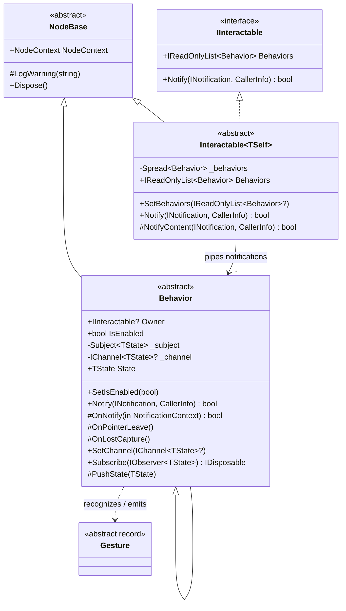

# Interaction Pipeline Proposal (`VL.Fu.Core.Interaction`)

## 1. Overview & Goals

This proposal defines the architecture for the `VL.Fu` interaction pipeline, bridging `VL.Skia`'s `IBehavior.Notify(INotification, CallerInfo)` mechanism with `VL.Fu`'s node hierarchy (`Interactable<TSelf>`), reactive `IObservable<TState>` streams, and `IChannel<T>` sinks.

### Core Requirements
* **Pluggable Behaviors:** `Interactable<TSelf>` accepts `IReadOnlyList<Behavior>` on the facade (stored internally as `Spread<Behavior>`).
* **ProcessNode Base Class:** `Behavior` is the base `[ProcessNode]` class for all concrete behaviors.
* **Reactive & Channel Outputs:** `Behavior<TState> : Behavior, IObservable<TState>` emits state/gesture transitions both as an `IObservable<TState>` stream and into optional `IChannel<T>` sinks, while also exposing the current `State` for mainloop polling.
* **Notification Categories:** Support **Pointer** (unified Mouse + Touch/Gesture), **Mouse** (buttons, move, wheel), and **Key** (key down/up/press + focus) notifications.
* **Gesture Recognition:** Recognize structured `Gesture` / `BehaviorState` records when processing notifications in local node coordinates.

---

## 2. How `VL.Skia` Notification Piping Works

To integrate seamlessly with standard `VL.Skia` renderers, layers, and widgets, `VL.Fu` follows `VL.Core.Skia` conventions:

1. **Synchronous Front-to-Back Routing:**
   * `IBehavior.Notify(INotification notification, CallerInfo caller)` is called synchronously on the UI thread when input events arrive.
   * Returning `true` marks the notification as consumed and short-circuits further routing.
   * Composite layers (`Group`, `SpectralGroup`) route in **reverse draw order** (last drawn = topmost = first notified).
2. **Coordinate Mapping via `PositionInWorldSpace`:**
   * In `VL.Lib.IO.Notifications`, `notification.Position` is always in **window pixel space**.
   * `TransformUpstream.Notify` pushes its local `SKMatrix` onto `CallerInfo`, inverts `caller.Transformation`, and wraps the notification via `notification.WithSender(new IntermediateTransformNotificationSender(invMatrix, notification))`.
   * Downstream consumers read **`notification.PositionInWorldSpace`**, which delegates to `((IWorldSpace2d)notification.Sender).MapFromPixels(notification)`.
   * Because `IntermediateTransformNotificationSender` is `internal` to `VL.Core.Skia`, `VL.Fu` provides its own `internal sealed class LocalSpaceNotificationSender : IWorldSpace2d, IProjectionSpace` so both `FuNode` behaviors and any `ILayer` inside a `RegionProvider` receive accurate local coordinates in `(0, 0, Layout.Width, Layout.Height)`.

---

## 3. Class Hierarchy & Core Types



### 3.1 `NotificationContext` (Passed from `Interactable` to `Behavior`)
When `Interactable<TSelf>` pipes a notification to its attached `Behaviors`, it provides precomputed local context so each behavior does not need to invert matrices or query Yoga layout repeatedly:

```csharp
public readonly record struct NotificationContext(
    IInteractable Node,
    INotification Notification,
    CallerInfo Caller,
    RectangleF LocalBounds,     // (0, 0, Layout.Width, Layout.Height)
    Vector2? LocalPosition,     // PositionInWorldSpace if INotificationWithPosition, else null
    bool IsInside,              // LocalBounds.Contains(LocalPosition) && within ClipArea
    bool IsCaptured             // True if this behavior currently holds pointer capture
);
```

### 3.2 `Behavior` & `Behavior<TState>`
* **`Behavior : NodeBase, IBehavior`**
  * Base class for all behaviors.
  * Can be plugged into `Interactable.SetBehaviors(...)` as part of `IReadOnlyList<Behavior>`, and also implements `VL.Skia.IBehavior` directly.
  * Lifecycle hooks for `OnNotify(in NotificationContext ctx)`, `OnPointerLeave()`, `OnLostCapture()`, and `OnLostFocus()`.
* **`Behavior<TState> : Behavior, IObservable<TState>`**
  * Holds `protected TState _state;` with `public TState State => _state;` for frame-based getters.
  * Implements `IObservable<TState>` (lazily allocating a `Subject<TState>` only when subscribed).
  * Accepts an optional sink channel via `[Fragment] public void SetChannel(IChannel<TState>? channel)`.
  * Calling `protected void PushState(TState next)` updates `_state`, pushes to `_channel?.OnNext(next)` (or `SetValueAndAuthor`), and emits on `_subject?.OnNext(next)`.
  * Concrete behaviors can also accept specialized secondary `IChannel<T>` sinks (e.g., `IChannel<float>` or `IChannel<Vector2>` for value sliders/scroll offsets, `IChannel<bool>` for bang/toggle triggers).

### 3.3 `Gesture` & `BehaviorState` Records
`Gesture` (or `BehaviorState`) records represent immutable snapshots of an interaction state transition:
* **`PointerState` / `HoverState`:** `(bool IsHovered, Vector2 LocalPosition, Vector2 NormalizedPosition, Keys Modifiers)`
* **`PressState` / `ClickGesture`:** `(bool IsHovered, bool IsPressed, bool IsClicked, int ClickCount, MouseButtons Buttons, Vector2 LocalPosition)`
* **`DragGesture`:** `(GesturePhase Phase, Vector2 StartPosition, Vector2 CurrentPosition, Vector2 Delta, Vector2 TotalOffset, Keys Modifiers)`
* **`ScrollGesture` (Wheel / Pan):** `(Vector2 Delta, Vector2 LocalPosition, Keys Modifiers)`
* **`KeyGesture`:** `(KeyNotificationKind Kind, Keys KeyCode, char KeyChar, Keys Modifiers)`

---

## 4. Notification Routing Pipeline (`Interactable<TSelf>.Notify`)

`Interactable<TSelf>.Notify(INotification notification, CallerInfo caller)` mirrors `Renderable<TSelf>.Render(CallerInfo)` in **reverse order**:

```text
Incoming Notify(notification, caller)
  │
  ├─ 1. Guards: if (!HasLayout || !IsDisplayed) return false;
  │
  ├─ 2. Root Capture / Hover / Focus Pre-Pass (at Root only):
  │     - If a behavior holds Pointer Capture, route positional move/up/lost to it first.
  │     - If notification is KeyNotification, route to Focused node/behavior first.
  │
  ├─ 3. Space Transform:
  │     - innerCaller = caller.WithTransformation(caller.Transformation.PreConcat(LocalTransformation))
  │     - Invert innerCaller.Transformation -> wrap notification with LocalSpaceNotificationSender
  │     - Extract localPos = posNotification.PositionInWorldSpace
  │
  ├─ 4. Clip Gate (for Children):
  │     - If positional and ClipArea.HasValue && !ClipArea.Value.Contains(localPos) -> skip Step 5
  │
  ├─ 5. Children (Reverse Order: count - 1 down to 0):
  │     - For each child in reverse:
  │         if (child.Notify(localNotification, innerCaller)) return true;
  │
  ├─ 6. Inner Content Hook (NotifyContent):
  │     - Overridden by Renderable<TSelf> to call Layer?.Notify(localNotification, innerCaller)
  │       (guarded by ClipArea if ClipLayer is enabled)
  │
  └─ 7. Self Behaviors:
        - Check isInside = new RectangleF(0, 0, Layout.Width, Layout.Height).Contains(localPos)
        - Build NotificationContext(this, localNotification, innerCaller, localBounds, localPos, isInside, ...)
        - For each behavior in _behaviors:
            if (behavior.Notify(in ctx)) return true;
        - Return false
```

---

## 5. Pointer Capture, Hover Leave & Focus Semantics

Standard `VL.Skia` layer routing stops at the first `Notify` returning `true`, which creates three classic UI edge cases that `Interactable<TSelf>` solves at the tree root:

1. **Pointer Capture (Dragging Outside Bounds):**
   * When a user presses down on a slider, scrollbar, or button (`MouseDown` / `TouchDown`) and drags outside `(0, 0, Layout.Width, Layout.Height)` (or outside a parent's `ClipArea`), the active `Behavior` requests capture.
   * While captured, subsequent `MouseMove` / `TouchMove` and `MouseUp` / `TouchUp` / `DeviceLost` notifications are transformed into the capturing node's local space and delivered directly to the captured behavior until release.
2. **Hover Enter / Leave Tracking:**
   * When the pointer moves from Node A to Node B (or exits the window), Node A must reset `IsHovered = false` even if Node B consumes the `MouseMove` notification first.
   * The root tracks the previously hovered `Interactable` / `Behavior` set and invokes `OnPointerLeave()` on any behavior that was hovered on the previous pointer event but was not reached on the current one.
3. **Keyboard Focus:**
   * `KeyNotification` has no position (`!INotificationWithPosition`).
   * An `Interactable` (or a `KeyBehavior`) becomes the root's `FocusedTarget` when clicked (if focusable) or programmatically via an `IChannel<bool>` focus channel. `KeyNotification`s route directly to the focused target (with an option on `KeyBehavior` for global/unfocused listening).

---

## 6. Supported Notification & Behavior Matrix

| Category | Incoming `VL.Lib.IO.Notifications` | Planned Concrete Behaviors | Primary `TState` / Sinks (`IChannel<T>`) |
|---|---|---|---|
| **Pointer** *(Unified Mouse + Touch)* | `MouseDown/Move/Up/Click/Lost`, `TouchNotification` (`Primary`) | `HoverBehavior`, `PressBehavior`, `ClickBehavior`, `ToggleBehavior`, `DragBehavior` | `IChannel<bool>` (hover/press/toggle), `IChannel<Vector2>` / `IChannel<float>` (drag/slider) |
| **Mouse** *(Desktop-specific)* | `MouseButtonNotification`, `MouseWheelNotification`, `MouseHorizontalWheelNotification` | `MouseButtonBehavior` (Left/Right/Middle, double-click), `WheelBehavior` | `IChannel<MouseState>`, `IChannel<Vector2>` (scroll delta / accumulated scroll) |
| **Touch / Multi-Touch** | `TouchNotification` (all `Id`s), `GestureNotification` (`Zoom`, `Pan`, `Rotate`) | `TouchBehavior`, `PinchZoomBehavior` | `IChannel<Spread<TouchPoint>>`, `IChannel<GestureState>` |
| **Key** | `KeyDownNotification`, `KeyUpNotification`, `KeyPressNotification`, `KeyboardLostNotification` | `KeyBehavior`, `HotkeyBehavior`, `TextInputBehavior` | `IChannel<KeyGesture>`, `IChannel<string>` |

---

## 7. Implementation Phases

1. **Phase 1 — Space Transform & Tree Routing (`Interactable<TSelf>`):**
   * Implement `LocalSpaceNotificationSender : IWorldSpace2d, IProjectionSpace`.
   * Add `Behaviors` (`Spread<Behavior>` internally, `IReadOnlyList<Behavior>` on facade) and `[Fragment(Order = PinOrder.Behavior)] SetBehaviors(...)` on `Interactable<TSelf>`.
   * Implement `Interactable<TSelf>.Notify` and `Renderable<TSelf>.NotifyContent` (for `Layer?.Notify`), respecting `HasLayout`, `IsDisplayed`, `LocalTransformation`, and `ClipArea`.
2. **Phase 2 — `Behavior` & `Behavior<TState>` Base Classes:**
   * Implement `Behavior : NodeBase, IBehavior` and `Behavior<TState> : Behavior, IObservable<TState>`.
   * Wire `State` property, `IObservable<TState>` subscription management (disposed on `Dispose(bool)`), and `IChannel<TState>` sink updates (`SetChannel`).
3. **Phase 3 — Capture, Hover Leave & Focus Management:**
   * Add root-level interaction state (`CapturedBehavior`, `HoveredBehaviors`, `FocusedTarget`) so drags survive leaving node bounds, hover states reliably clear, and keyboard events route to focused behaviors.
4. **Phase 4 — Core Concrete Behaviors & `Gesture` Records:**
   * Implement `Gesture` / state records in `Gesture.cs` and core behaviors (`HoverBehavior`, `ClickBehavior`, `ToggleBehavior`, `DragBehavior`, `WheelBehavior`, `KeyBehavior`).
