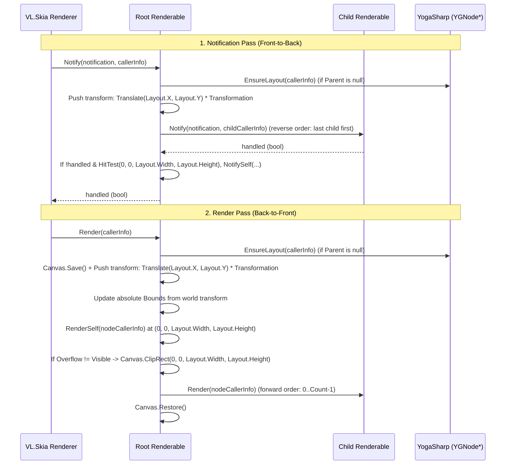

# Proposal: `Layoutable<TSelf>` & Tree Graph Architecture (`Fu.Core`, `YogaSharp`, `VL.Core.Skia`)

## 1. Confirmed Architectural Decisions

* **Layout Trigger (Option 1C — Hybrid):**
  * Explicit `UpdateLayout(float width, float height, YGDirection direction)` can be called directly when needed.
  * Root nodes (`Parent is null`) automatically ensure layout at the start of `Render(CallerInfo)` and `Notify(INotification, CallerInfo)` if `_handle->IsDirty()` or the root viewport size changed.
* **Coordinate Space & Units (Caller's Space by Default + Future Configurable Layout Root):**
  * **Precedent / Base Implementation:** By default, `Layoutable<TSelf>` works directly in whatever space `Render(CallerInfo)` / `Notify(INotification, CallerInfo)` was called in (`Normalized`, `DIP`, `DIPTopLeft`, `PixelTopLeft`, `WithinCommonSpace`, or after a `Camera` / `Transform` node).
  * `YGConfig.SetPointScaleFactor(0f)` is used by default so Yoga does not round fractional coordinates (e.g. `1 unit = 100px` in vvvv `Normalized` / `DIP` space) to integers.
  * When a root node (`Parent is null`) needs the available viewport size in the current caller space, it maps `caller.ViewportBounds` through `caller.Transformation.TryInvert(out var inv)` (`inv.MapRect(caller.ViewportBounds)`).
  * **Future Extension:** A dedicated configurable Layout Root node can later override the space/sizing mode or `YGConfig` (`PointScaleFactor`, `UseWebDefaults`, etc.) for its subtree.
* **Rectangles & Transformations (Option 3A — Minimal & Compositional):**
  * **No extra `LocalBounds`, `ContentBounds`, or `ScrollOffset` on `Layoutable<TSelf>`!**
  * We only have **two** rectangles across the entire hierarchy, and each already exists:
    1. **`Layout` (`ILayoutable.Layout`):** Parent-relative `RectangleF(Left, Top, Width, Height)` straight from Yoga (`_handle->GetComputedLeft()`, etc.).
    2. **`Bounds` (`IRendering.Bounds` on `Renderable`):** Absolute/root-positioned `RectangleF?` representing the final transformed bounds of the element.
  * **One `Transformation` (`ILayoutable.Transformation`):**
    * `Matrix Transformation` transforms the node itself (and naturally its children via `CallerInfo` matrix concatenation).
    * **Scrolling is just composition, not a special property on `Layoutable`:** A ScrollView is simply a clipped outer container whose child is a content container with a `Transformation` (or `Draggable` behaviour) translating that inner container!

---

## 2. Minimal `ILayoutable` & `Layoutable<TSelf>` Design

`ILayoutable` stays exactly as clean as it currently is in [Layoutable.cs](../../Fu.Core/Layout/Layoutable.cs):

```csharp
public interface ILayoutable
{
    /// <summary>Parent-relative layout box computed by Yoga (Left, Top, Width, Height).</summary>
    RectangleF Layout { get; }

    /// <summary>Transform applied to this node relative to its Yoga Layout slot.</summary>
    Matrix Transformation { get; }
    void SetTransformation(Matrix transformation);
}
```

### Why Scroll Works Without `ScrollOffset` or `ContentBounds`
In a node-based UI graph, scrolling does not need special-case properties on every node:
```text
ScrollViewport (Overflow = Hidden, fixed Width/Height)
  └── ScrollContent (Children live here; Transformation = Translation(0, -scrollY, 0))
        ├── Item 1
        ├── Item 2
        └── Item 3
```
* `ScrollViewport` stays at its Yoga `Layout` and clips to `(0, 0, Layout.Width, Layout.Height)`.
* `ScrollContent` is a regular child node whose `Transformation` is mutated by a `Draggable` / `Scroll` behaviour.
* Yoga never recalculates layout during scrolling because only `ScrollContent.Transformation` changes.

---

## 3. How `Layout` (Parent-Relative) and `Bounds` (Absolute) Relate

During layout calculation and the `CallerInfo` pass:

1. **`Layout` (`Layoutable<TSelf>`):**
   * Directly mirrors Yoga's parent-relative output:
     ```csharp
     _layout = new RectangleF(
         _handle->GetComputedLeft(),
         _handle->GetComputedTop(),
         _handle->GetComputedWidth(),
         _handle->GetComputedHeight()
     );
     ```
2. **Local-to-Parent Transform Step:**
   * At each node, its local origin `(0, 0)` is placed at `(Layout.X, Layout.Y)` in its parent's space, and then transformed by `Transformation`:
     $$M_{\text{local}\to\text{parent}} = \text{Translation}(\text{Layout.X}, \text{Layout.Y}) \times \text{Transformation}$$
   * Accumulated down the tree from the root, every node has a world/root matrix:
     $$M_{\text{world}} = M_{\text{parent\_world}} \times M_{\text{local}\to\text{parent}}$$
3. **`Bounds` (`Renderable.Bounds`):**
   * The node's local rectangle `(0, 0, Layout.Width, Layout.Height)` mapped by its accumulated root/world transform into absolute space:
     ```csharp
     // Local rect (0, 0, Layout.Width, Layout.Height) mapped by accumulated matrix:
     Bounds = worldSKMatrix.MapRect(new SKRect(0, 0, Layout.Width, Layout.Height)).ToRectangleF_();
     ```
   * When a node is dragged (`SetTransformation`), its `Layout` (its Yoga slot in the parent) stays unchanged, while its `Bounds` (its actual absolute position in root space) updates with `Transformation`.

---

## 4. Layout Calculation & Dirty Propagation in `Layoutable<TSelf>`

```csharp
public unsafe void CalculateLayout(
    float availableWidth = float.NaN,
    float availableHeight = float.NaN,
    YGDirection direction = YGDirection.LTR)
{
    if (_handle is null)
        return;

    _handle->CalculateLayout(availableWidth, availableHeight, direction);
    ApplyComputedLayout();
}

private unsafe void ApplyComputedLayout()
{
    if (_handle is null)
        return;

    if (_handle->GetHasNewLayout())
    {
        _layout = new RectangleF(
            _handle->GetComputedLeft(),
            _handle->GetComputedTop(),
            _handle->GetComputedWidth(),
            _handle->GetComputedHeight()
        );
        _handle->SetHasNewLayout(false);
        OnLayoutCalculated(_layout);
    }

    foreach (var child in Children)
        child.ApplyComputedLayout();
}

protected virtual void OnLayoutCalculated(RectangleF layout) { }
```

### Root Auto-Trigger (`EnsureLayout`)
When `Render(CallerInfo caller)` or `Notify(INotification notification, CallerInfo caller)` is called on a root node (`Parent is null`):
* Check if viewport size changed or `_handle->IsDirty()`.
* Call `CalculateLayout(viewportWidth, viewportHeight)`.

---

## 5. Intrinsic Sizing (`YGMeasureFuncDelegate`) for Leaf Nodes

Leaf nodes (Text, Icon, Image, or wrapped `ILayer`) that size themselves from content rather than children can opt into Yoga's measure callback:

* Store a `GCHandle` to `this` in `_handle->SetContext((void*)GCHandle.ToIntPtr(_gcHandle))` (freed in `Dispose(bool)`).
* Provide a virtual `MeasureCore(float width, YGMeasureMode widthMode, float height, YGMeasureMode heightMode)` hook.
* Note: Yoga only allows `SetMeasureFunc` on leaf nodes (`Children.Count == 0`).

---

## 6. End-to-End Frame Pipeline (`Layoutable` $\to$ `Interactable` $\to$ `Renderable`)



### Summary of Responsibilities Across Layers

| Layer | Responsibility | Properties / Hooks |
| :--- | :--- | :--- |
| **`Layoutable<TSelf>`** | Owns `YGNode*`, syncs Yoga tree in `OnChildrenChanged`, runs `CalculateLayout`, holds parent-relative `Layout` and local `Transformation`. | `RectangleF Layout`, `Matrix Transformation`, `SetTransformation(Matrix)`, `CalculateLayout(...)` |
| **`Interactable<TSelf>`** | Pushes node transform (`Translate(Layout.X, Layout.Y) * Transformation`), routes `Notify` to `Children` in reverse order, hit-tests `(0, 0, Layout.Width, Layout.Height)` in local space. | `Notify(INotification, CallerInfo)`, `NotifySelf(...)` |
| **`Renderable`** | Computes absolute `Bounds` (`IRendering.Bounds`), draws `RenderSelf` in `(0, 0, Layout.Width, Layout.Height)`, clips if `Overflow != Visible`, renders `Children` in forward order. | `RectangleF? Bounds`, `Render(CallerInfo)`, `RenderSelf(CallerInfo)` |

