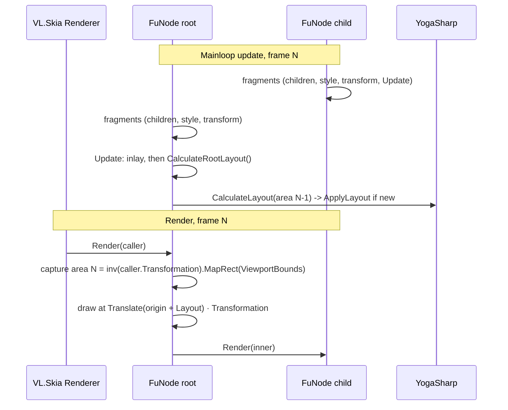

# Proposal: Layout Driver (`FuNode`, `Renderable<TSelf>`, `Layoutable<TSelf>`)

> Code samples are guidance for the shape of the implementation, not code to copy.

Replaces the layout trigger of [proposal-layoutable.md](proposal-layoutable.md) (§ 1.1 "The root owns the layout trigger", § 4.3, and the `CalculateLayout` steps in the § 5 diagram). Everything else there stays.

## 1. Decisions

### 1.1 ImGui-style driver: capture in `Render`, lay out in `Update`

* Same pattern as VL.ImGui's `ToSkiaLayer`, which keeps the last `CallerInfo` from `Render` and sizes the UI from `_lastCallerInfo.ViewportBounds` in its update.
* **Capture:** `Renderable.Render` on a root (`Parent is null`) stores the layout area: the viewport mapped back into the caller's space.

  ```text
  area = inv(caller.Transformation).MapRect(caller.ViewportBounds)
  ```

  `ViewportBounds` is in window pixels and `caller.Transformation` maps caller space to window pixels (`CallerInfoExtensions.InViewport`), so the inverse gives the area in the caller's units.
* **Drive:** `FuNode` overrides the virtual `RegionProvider.Update` fragment. It runs the inlay first (`base.Update()`), then lays out the tree if it is a root and an area is known.
* **Order inside a frame:** children are upstream pins, so every descendant's fragments ran before the root's `Update`. Layout sees this frame's styles and children.
  * The order of a node's own fragments comes from how they are placed in the patch, not from `[Fragment(Order = ...)]`, which only orders the pins. A root's own setters (`SetStyle`, `SetBounds`) placed after its `Update` reach layout one frame late. This is accepted.
* **One frame of lag:** frame N's `Update` uses the area captured by frame N-1's `Render`. Drawing and hit testing both read the same layout, so they never disagree. This is the same lag as in ImGui, and accepted.

### 1.2 Size source: explicit `SetBounds`, viewport as fallback

* **How VL.Skia represents bounds** (`VL.Core.Skia`, `VL.Skia`):
  * `ILayer.Bounds` / `IRendering.Bounds` is `RectangleF?`, in the space the layer is rendered in (its caller's space). `null` means unknown, and `RectangleExtensions.Union` skips it.
  * **Forwarded:** `LinkedLayerBase` and `DeferredLayer` return `Input?.Bounds`. `SetRendering` returns the bounds of its `IRendering`.
  * **Mapped:** `TransformUpstream` returns `M.MapRect(Input.Bounds)`, the box around the transformed input in the outer space.
  * **Combined:** `Group` returns the union of its inputs' bounds.
  * **Declared:** `SetRender` has a `RectangleF? bounds` pin and returns it as is, whatever it draws. `InViewportUpstream` returns the rectangle it was given, which is also the viewport its upstream lays out into; content overflowing it doesn't change it.
  * **Unknown:** ImGui's `ToSkiaLayer` returns `default`.
  * The earlier `VL.Fu5` `Renderable` returned the raw Yoga `Layout`, ignoring its own transformation.
* **Fu follows two of these:**
  * **Computed** (forwarded/mapped kind): the layout rectangle mapped by `LocalTransformation`, as today.
  * **Declared** (`SetRender` / `InViewport` kind): `SetBounds`. On a root it is exactly `InViewport`: the declared rectangle in the caller's space, which the tree lays out into.
* **Layout area of a root** = explicit bounds if set, otherwise the captured viewport. Both are rectangles in the caller's space, so both paths go through the same `CalculateLayout(area, direction)`. The viewport is just the implicit bounds.
* **`SetBounds(RectangleF? bounds)`** on `Renderable<TSelf>`, a plain method without `[Fragment]`, so it is not a pin and is called explicitly (from a patch through the node's state, or from C#):
  * The type is `RectangleF?`, like `SetRender`'s pin and `ILayer.Bounds`, so the getter and setter match: `RectangleF? Bounds` / `SetBounds(RectangleF?)`.
  * **Set:** `Bounds` returns it, and a root lays out into it: top-left = origin, size = available size.
  * **Null:** the viewport is used, and `Bounds` is computed from the layout, as today.
  * Follows the `public X => _x; public void SetX(...)` pattern: what was set is what `Bounds` returns.
* **No feedback loop:** explicit bounds are user input and never written by layout. The computed bounds stay a separate field that layout writes.
* **Works without a renderer:** a root with explicit bounds lays out in `Update` without any `Render`, so offscreen trees and tests need no `CallerInfo`.
* **Requested vs actual:** with explicit bounds, `Bounds` reports the area the UI was given, not the rectangle it ended up in.
  * Differences come from root margins, a root `Width`/`Height` style, or a root `Transformation`, which rotates or scales the content inside the area while `Bounds` stays the unrotated area.
  * VL consumers (`Group` union, tooltips) see a stable panel rectangle, as with `InViewport`. The actual rectangle stays readable through `Layout`.
* **On a child:** the parent's layout decides its place and size, so explicit bounds don't affect layout and a warning is logged.
  * `Bounds` still returns the set value, as `SetRender` does: declared bounds always win.
  * This makes it a way to declare a different rectangle to VL (e.g. for a `Group` union), not to place the child.
* **Non-finite values** (NaN, infinity, negative size) are dropped with a warning, falling back to the viewport.
* Inside the area, Yoga's root rules still apply (`calculateLayout` in `yoga/algorithm/CalculateLayout.cpp`):

  | Root style | Result |
  | :--- | :--- |
  | `Width` / `Height` set | That size; percentages resolve against the area |
  | Only `MaxWidth` / `MaxHeight` | Content size, capped |
  | Nothing | Stretches to the area |

* The **computed** bounds (where the node ended up, in the parent's space or the caller's for a root) are never an input. Feeding them back as the available size would make the layout depend on its own previous result. It would stick at the first size, shrink by the margins every frame, or grow with a transform scale or rotation. It would also apply `Transformation` twice. Only the explicit value is an input.

### 1.3 Origin: root at the area's top-left (confirmed)

* The root's `LocalTransformation` gains the area's top-left:

  ```text
  local = Translate(origin + Layout.XY) · Transformation    // origin is (0, 0) for every non-root
  ```

* In top-left spaces (`DIPTopLeft`, `PixelTopLeft`) the origin is (0, 0), so nothing changes. In centred spaces (`DIP`, `Normalized`) the UI starts in the window's top-left instead of its centre.
* Because the origin is part of `LocalTransformation`, `Render`, `Bounds` and the future `Notify` pick it up with no extra code.
* The origin is applied together with the layout, in `Update`, never directly from `Render`. Otherwise a resize would move the root before it is laid out again.

### 1.4 No layout before the first area (accepted)

* A root without explicit bounds that was never rendered has no area, so `Update` does nothing and `HasLayout` stays false. `Render` draws nothing until the frame after its first capture.
* A root with explicit bounds has an area from the start and lays out on its first `Update`.
* This avoids a content-sized first frame that jumps to the viewport size on the next one.
* It also protects nodes that are about to become children. On the frame a node is attached, its own `Update` runs before the parent's `SetChildren` (the parent is downstream), so the node still looks like a root. A node that was never rendered as a root skips layout there.

### 1.5 Becoming or leaving a root

* **Attached** (`OnParentChanged` with a new parent): the captured area and the origin are cleared. Explicit bounds are kept, since they are user input, but they no longer drive layout. The parent's layout positions the node from then on.
  * A root that was rendered and then attached lays itself out once on the attach frame, before its new parent takes over. This is harmless redundant work, and the parent's pass overwrites it in the same frame.
* **Detached:** the node keeps its last `Layout` and has no area. If something renders it as a root, it draws once at its old place, then lays out into the new area on the next frame.

### 1.6 No dirty tracking in Fu

* `Update` calls Yoga every frame on a root. Yoga's root cache returns immediately when nothing is dirty and the available size is the same, and `GetHasNewLayout()` stays false, so `ApplyLayout` doesn't run.
* The NaN-safe size comparison from proposal-layoutable.md § 4.3 is no longer needed: Fu doesn't compare sizes, Yoga does.
* Only the origin is compared in Fu, so `LocalTransformation` is rebuilt only when it moved.

---

## 2. Shape

### 2.1 `Layoutable<TSelf>`: origin and area overload

```csharp
private Vector2 _origin; // the root's place in the caller's space; zero for every non-root

/// Lays out the tree into `area`, with the root placed at its top-left.
/// The public CalculateLayout(width, height, direction) becomes CalculateLayout(new RectangleF(0, 0, width, height), direction).
protected void CalculateLayout(RectangleF area, YGDirection direction)
{
    // same guards as today: no handle, or Parent is not null -> warning
    SetOrigin(new Vector2(area.X, area.Y));     // rebuilds LocalTransformation only if it changed
    _handle->CalculateLayout(area.Width, area.Height, direction);
    if (_handle->GetHasNewLayout())
        ApplyLayout();
}

private void UpdateLocalTransformation()
{
    _localTransformation = SKMatrix
        .CreateTranslation(_origin.X + _layout.X, _origin.Y + _layout.Y)
        .PreConcat(_transformation.ToSKMatrix());
    OnLocalTransformationChanged();
}

protected override void OnParentChanged(TSelf? oldParent, TSelf? newParent)
{
    base.OnParentChanged(oldParent, newParent);
    if (newParent is not null)
        SetOrigin(Vector2.Zero);
    UpdateConfig();
}
```

* `ILayoutable.CalculateLayout(width, height, direction)` stays for manual use (tests, offscreen trees). It lays out at origin (0, 0).
  * A `FuNode` root that is also driven manually ends up with whichever call ran last. This is documented, not guarded.

### 2.2 `Renderable<TSelf>`: capture and root layout

```csharp
private RectangleF? _explicitBounds;  // user input, never written by layout
private RectangleF? _computedBounds;  // written in OnLocalTransformationChanged, as today
private RectangleF? _viewportArea;    // caller space, from the last Render as a root

public RectangleF? Bounds => _explicitBounds ?? _computedBounds;

public void SetBounds(RectangleF? bounds)
{
    // non-finite or negative size -> LogWarning, treated as null
    // set on a child -> LogWarning: "Bounds only size a root; this node's parent lays it out."
    _explicitBounds = bounds;
}

public void Render(CallerInfo caller)
{
    if (Parent is null)
        CaptureLayoutArea(caller);

    if (!HasLayout)
        return;
    // ... unchanged
}

/// Lays out the tree into the explicit bounds, otherwise into the viewport captured by the last Render.
/// Does nothing on a child, or on a root that has neither yet.
protected void CalculateRootLayout()
{
    if (Parent is not null || (_explicitBounds ?? _viewportArea) is not { } area)
        return;

    CalculateLayout(area, YGDirection.LTR);  // direction becomes a style later (§ 4)
}

private void CaptureLayoutArea(CallerInfo caller)
{
    // A degenerate caller matrix (e.g. scale 0) keeps the last area instead of producing NaN.
    if (!caller.Transformation.TryInvert(out var inverse))
        return;

    _viewportArea = inverse.MapRect(caller.ViewportBounds).ToRectangleF_();
}

protected override void OnParentChanged(IFuNode? oldParent, IFuNode? newParent)
{
    base.OnParentChanged(oldParent, newParent);
    if (newParent is not null)
        _viewportArea = null;
}
```

* `Renderable` owns the capture because it is the first layer that knows `CallerInfo`. `Layoutable` only learns about rectangles.
* Under a rotated caller matrix the area is the axis-aligned box of the viewport in the caller's space, as in proposal-layoutable.md § 5.

### 2.3 `FuNode`: the driver

```csharp
[Fragment]   // its place in the patch decides when it runs; Order only sorts pins
public override void Update()
{
    base.Update();          // inlay: may set the layer, styles and nodes patched inside
    CalculateRootLayout();
}
```

* `RegionProvider.Update` stays `[Fragment] virtual` and knows nothing about layout. A `RegionProvider` that isn't a `FuNode` (none exist yet) is not driven.
* `FuNodeSpectral` inherits the override.

---

## 3. Frame Pipeline



---

## 4. Out of Scope

* **`SetDirection`**: a Yoga style node, added later. Yoga gives a node's own direction priority over the one passed to `CalculateLayout` unless it is `Inherit`, so the root passes `LTR` and a subtree can switch to RTL. No config field and no pin.
* **`Notify` routing**: it gets the origin for free through `LocalTransformation`; the routing itself belongs to its own proposal.
* **One root in several renderers**: the last `Render` wins, so the layout can alternate between sizes. ImGui has the same limitation. Documented, not solved.
* **`Normalized` space**: the area is about 2 units high, so pixel-like style values look huge. This is expected; it will be noted in the user docs.

---

## 5. Open Questions

None. `Bounds` on a child with explicit bounds follows `SetRender`: the declared value wins (§ 1.2).

---

## 6. Tests

* `Render` on a root captures the area. A `DIP`-style centred caller gives a negative top-left.
* `Render` on a child captures nothing.
* `CalculateRootLayout` without a captured area leaves `HasLayout` false.
* After capture plus `CalculateRootLayout`:
  * the root stretches to the area;
  * a root `Width` style wins over the area width;
  * `Width 50%` resolves against the area.
* The origin moves `LocalTransformation` and `Bounds` but not `Layout`. Rendering twice at the same area changes nothing (no `OnLayoutChanged`).
* Explicit bounds:
  * a root lays out into them without any `Render`, with the origin at their top-left;
  * they win over a captured viewport;
  * `Bounds` returns them;
  * dropping them falls back to the viewport and the computed `Bounds`;
  * a non-finite value warns and is ignored;
  * set on a child, they warn and don't affect layout, while `Bounds` returns them.
* Attaching a former root clears its area and origin.
* A singular caller matrix keeps the previous area.
* `ILayoutable.CalculateLayout(w, h)` still lays out at origin (0, 0).
