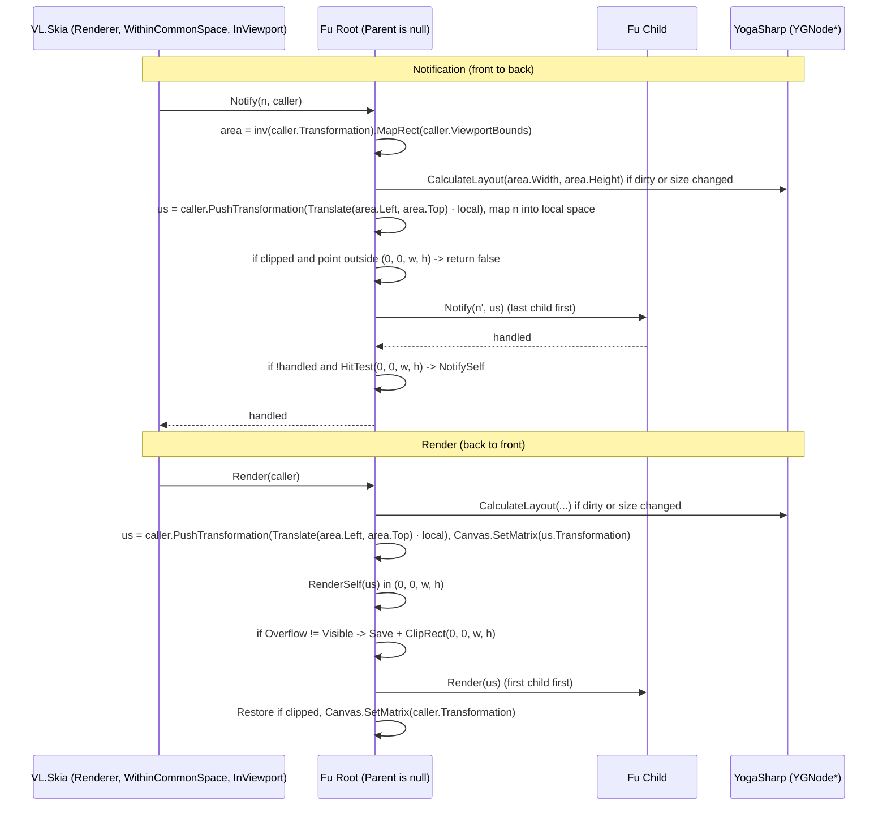

# Proposal: Layout Roots & `Layoutable<TSelf>` (`VL.Fu.Core`, `YogaSharp`, `VL.Core.Skia`)

> Code samples are guidance for the shape of the implementation, not code to copy.

## 1. Decisions

### 1.1 Layout roots (no separate `Layout` node)

* Any Fu node with `Parent is null` is a **layout root**. There is no extra `Layout` node to place.
* The root lays out into the **caller's viewport, in the caller's space**:
  * Layout area = the viewport mapped back into the caller's space, `inv(caller.Transformation).MapRect(caller.ViewportBounds)`.
  * The root is placed at that area's top-left, so centred spaces (`Normalized`, `DIP`) don't start the UI in the middle of the window. Yoga is top-left / y-down, like every vvvv Skia space.
  * Units are the caller's units as they are (in `DIPTopLeft`, 1 unit = 100 DIP, so `Padding = 0.08` is 8 DIP).
* Space and placement come from **existing VL.Skia nodes downstream** instead of Fu pins:
  * `WithinCommonSpace` selects the space (e.g. `DIPTopLeft`).
  * `InViewport` limits the UI to a rectangle in the caller's space.
* The root owns the layout trigger: `Render` / `Notify` call `CalculateLayout` when the root is dirty or the available size changed.
* Notifications are mapped into local space by a Fu-owned sender (`IWorldSpace2d`, `IProjectionSpace`), because VL's `IntermediateTransformNotificationSender` is `internal`.

### 1.2 Yoga configuration (`YogaConfig`, inherited)

Implemented in [YogaConfig.cs](../../VL.Fu/src/Core/Layout/YogaConfig.cs) and [Layoutable.cs](../../VL.Fu/src/Core/Layout/Layoutable.cs).

* `YogaConfig` is an immutable record with `YogaConfig.Default`:

  ```csharp
  public sealed record YogaConfig(float PointScaleFactor = 0f, YGErrata Errata = YGErrata.None, bool WebFlexBasis = true)
  {
      public static YogaConfig Default { get; } = new();
  }
  ```

  * `PointScaleFactor = 0` by default: no rounding, which is required because one unit is far bigger than a pixel.
  * `UseWebDefaults` is **not** part of the record. Yoga hits a fatal assert when a node's config is replaced by one with a different `UseWebDefaults`, so it is a Fu-wide constant, currently `true`: `flexDirection` defaults to `row`, `flexShrink` to 1 and `alignContent` to `stretch`, as on the web.
* **Inherited like a CSS property:** `ILayoutable.Config` / `SetConfig(YogaConfig?)` on any node; `null` inherits.
  * Effective config = own config, otherwise the parent's effective config, otherwise `YogaConfig.Default`.
  * Recomputed in `OnParentChanged` (attach, move, detach) and pushed down to children without their own config; a child with its own config stops the walk for its subtree.
  * It travels through the tree hooks, not through VL notifications (`INotification` is the input pipeline and only flows during `Notify`).
  * Caveat: Yoga rounds each node with its own config, so different `PointScaleFactor`s inside one tree can leave small gaps.
* **Native configs** are shared and reference counted (`YogaConfigCache`):
  * Equal records map to one native `YGConfig*`; nodes are created with the default one (`YGNode.New(config)`), not with Yoga's process-wide `YGConfig.GetDefault()`.
  * A node switches to the new config before releasing the old one, and releases its config when disposed; a native config is freed when no node uses it, so a patch animating a value doesn't leak one per frame.
  * `YogaConfig.Default` is pinned and never freed.
  * No `AppHost` service is involved: nodes need a config before they know their surroundings, tests run without a host, and a host-owned native config could be freed while nodes still point at it. An app-wide default `YogaConfig` service can be added later if needed.
* Automatic pixel snapping (`PointScaleFactor` = pixels per unit of the caller's space) is not automatic yet; users can set it through a config.

### 1.3 Rectangles & transformations (minimal & compositional)

* **No extra `LocalBounds`, `ContentBounds` or `ScrollOffset` on `Layoutable<TSelf>`.**
* Two rectangles, both already present:
  1. **`Layout` (`ILayoutable.Layout`):** parent-relative `RectangleF(Left, Top, Width, Height)`, straight from Yoga.
  2. **`Bounds` (`ILayer.Bounds` on `Renderable<TSelf>`):** the node's local rectangle in its **parent's space**, following the VL.Skia convention (`TransformUpstream` returns `M.MapRect(Input.Bounds)`, without the caller's matrix). It is computed from `Layout` and `Transformation`, so it is always current and needs no render pass.
* One `Transformation` (`ILayoutable.Transformation`):
  * `Matrix` (Stride) is the VL-facing facade; Fu converts to and from `SKMatrix` with helpers (§ 3).
  * Rotation and scale pivot around the node's top-left (CSS defaults to the centre). A transform-origin is a possible later addition.
* **Scrolling is composition:** a clipped outer container whose child is a content container moved by its `Transformation` (§ 2).

---

## 2. `ILayoutable` & Scrolling

`ILayoutable` as in [Layoutable.cs](../../VL.Fu/src/Core/Layout/Layoutable.cs):

```csharp
public interface ILayoutable : IStylable
{
    RectangleF Layout { get; }
    Matrix Transformation { get; }
    void SetTransformation(Matrix transformation);
    YogaConfig? Config { get; }
    void SetConfig(YogaConfig? config);
    void CalculateLayout(
        float availableWidth = float.NaN,
        float availableHeight = float.NaN,
        YGDirection direction = YGDirection.LTR);
}
```

```text
ScrollViewport (Overflow = Hidden, fixed Width/Height)
  └── ScrollContent (children live here; Transformation = Translation(0, -scrollY, 0))
        ├── Item 1
        ├── Item 2
        └── Item 3
```

* `ScrollViewport` stays at its Yoga `Layout` and clips to `(0, 0, Layout.Width, Layout.Height)`.
* `ScrollContent` is a regular child whose `Transformation` is changed by a `Draggable` / `Scroll` behaviour. The scroll range is `ScrollContent.Layout.Height - ScrollViewport.Layout.Height`.
* Yoga never recalculates layout while scrolling, since only a `Transformation` changes.
* The clip must also apply to notifications (§ 5), otherwise a scrolled-out item still catches clicks.

---

## 3. Transform Composition & `Bounds`

* Local-to-parent transform, applying `Transformation` first and then moving into the Yoga slot:

  ```csharp
  // Skia (column vectors)
  SKMatrix local = SKMatrix.CreateTranslation(Layout.X, Layout.Y).PreConcat(Transformation.ToSKMatrix());
  // Stride (row vectors), same transform
  Matrix local = Transformation * Matrix.Translation(Layout.X, Layout.Y, 0);
  ```

* World transforms are never stored. Each node pushes `local` onto the `CallerInfo` (`caller.PushTransformation(local)`), as `TransformUpstream` does.
* `LocalTransformation` (protected `SKMatrix` on `Layoutable`) caches `local`. It is rebuilt in `SetTransformation`, when `ReadLayout` sees a new `Layout` (before `OnLayoutChanged`), and once on the first layout pass. Each rebuild calls `protected virtual OnLocalTransformationChanged()`, where derived classes cache what they compute from it (bounds now, the inverse for notifications later).
* `Bounds` (on `Renderable<TSelf>`) is a cached field, so reading it every frame costs nothing. It is `null` until the node was laid out (`HasLayout`), since VL treats `null` as unknown and `Group` unions skip it:

  ```csharp
  private RectangleF? _bounds;
  public RectangleF? Bounds => _bounds;

  protected override void OnLocalTransformationChanged()
  {
      base.OnLocalTransformationChanged();
      if (!HasLayout)
          return;

      var layout = Layout;
      _bounds = LocalTransformation.MapRect(SKRect.Create(layout.Width, layout.Height)).ToRectangleF_();
  }
  ```

  Dragging a node (`SetTransformation`) leaves `Layout` (its Yoga slot) unchanged and moves `Bounds`.
* Conversion helpers (`Matrix` is a facade; Z, rotation around X/Y and the 3rd row/column are dropped):

  ```csharp
  // Stride: x' = x*M11 + y*M21 + M41   Skia: x' = ScaleX*x + SkewX*y + TransX
  public static SKMatrix ToSKMatrix(this Matrix m) =>
      new(m.M11, m.M21, m.M41,
          m.M12, m.M22, m.M42,
          m.M14, m.M24, m.M44);

  public static Matrix ToMatrix(this SKMatrix m) =>
      new(m.ScaleX, m.SkewY, 0, m.Persp0,
          m.SkewX, m.ScaleY, 0, m.Persp1,
          0, 0, 1, 0,
          m.TransX, m.TransY, 0, m.Persp2);
  ```

  Implemented as `internal static class MatrixExtensions` in `VL.Fu\src\Core\Extensions` (tested). Stride's `a * b` equals Skia's `a.PostConcat(b)`.
  Rectangles reuse `VL.Skia.Conversions` (`ToSKRect_` / `ToRectangleF_`) instead of new helpers.

---

## 4. Layout Calculation (`Layoutable<TSelf>`)

### 4.1 `CalculateLayout` (roots only)

```csharp
public unsafe void CalculateLayout(
    float availableWidth = float.NaN,
    float availableHeight = float.NaN,
    YGDirection direction = YGDirection.LTR)
{
    if (_handle is null)
        return;

    if (Parent is not null)
    {
        // Yoga would lay this subtree out as if it were a root and overwrite the parent's results.
        Log(LogLevel.Warning, "Only a root element can calculate layout; its root calculates it.");
        return;
    }

    _handle->CalculateLayout(availableWidth, availableHeight, direction);

    if (_handle->GetHasNewLayout())
        ApplyLayout();
}
```

### 4.2 `ApplyLayout` chain

Top-down from the root, as before, but without passing the parent's layout: Yoga positions are already parent-relative and `Bounds` is in the parent's space.

```csharp
private unsafe void ApplyLayout()
{
    ReadLayout();
    _handle->SetHasNewLayout(false);

    foreach (var child in Children)
    {
        if (child._handle->GetHasNewLayout())
            child.ApplyLayout();
        else
            child.ReadLayout(); // Yoga can move a child while reusing its cached size, without flagging it
    }
}

private unsafe void ReadLayout()
{
    var layout = new RectangleF(
        _handle->GetComputedLeft(),
        _handle->GetComputedTop(),
        _handle->GetComputedWidth(),
        _handle->GetComputedHeight());

    if (IsSameLayout(layout, _layout)) // exact, NaN-safe, component-wise
        return;

    var old = _layout;
    _layout = layout;
    OnLayoutChanged(old, layout);
}

protected virtual void OnLayoutChanged(RectangleF oldLayout, RectangleF newLayout) { }
```

* `Layout` has no setter; only `ReadLayout` writes it.
* `OnLayoutChanged` follows `OnParentChanged` / `OnChildrenChanged` and receives both values. Parents are updated before their children.
* Covered by tests: a child moved by a resized sibling while keeping its cached size is re-read; only nodes whose rectangle changed are reported; an unchanged pass reports nothing; a non-root call warns and does nothing.

### 4.3 Trigger on the root

* In `Render` / `Notify`, when `Parent is null`: recalculate when the root is dirty or the available size changed.
* Compare sizes NaN-safely (`a.Equals(b)`, not `a == b`); an unconstrained `NaN` size is otherwise never equal to itself and layout runs every frame.

---

## 5. Frame Pipeline (`Layoutable` → `Interactable` → `Renderable`)



* Non-root nodes do the same without the area step: their `local` already contains the Yoga slot.

* Transforms follow VL.Skia: `Canvas.SetMatrix` and restore the caller's matrix afterwards; `Save` / `Restore` only for clipping.
* Dragging (including `ScrollContent`) needs pointer capture: once a press is handled, moves and the release go to the capturing node even outside its bounds. Details belong to the gesture proposal.
* The layout area is the axis-aligned rectangle of the viewport in the caller's space; under a rotated caller transform the UI lays out in that bounding rectangle.

### Responsibilities

| Layer | Responsibility | Members |
| :--- | :--- | :--- |
| **`Layoutable<TSelf>`** | Owns `YGNode*`, syncs the Yoga tree in `OnChildrenChanged`, inherited `YogaConfig`, `CalculateLayout` on roots, `ApplyLayout` chain, parent-relative `Layout`, local `Transformation`. | `Layout`, `Transformation`, `SetTransformation`, `Config`, `SetConfig`, `EffectiveConfig`, `CalculateLayout`, `OnLayoutChanged` |
| **`Interactable<TSelf>`** | Root: layout trigger and area. Pushes the local transform, maps notifications into local space, respects clipping, routes to children last-first, hit-tests `(0, 0, w, h)`. | `Notify`, `NotifySelf` |
| **`Renderable<TSelf>`** | Root: layout trigger and area. `Bounds` in parent space (caller space for the root), `RenderSelf` in `(0, 0, w, h)`, clipping, children first-first. | `Bounds`, `Render`, `RenderSelf` |

---

## 6. Out of Scope

* **Measure functions** (intrinsic sizing for text, images, wrapped `ILayer`s). Hard to set up from a patch; revisit with text rendering. When added: one static `[UnmanagedCallersOnly]` callback resolving the node through `GetContext`, and a guard, because Yoga asserts fatally on a node with both a measure function and children.
* **Automatic pixel snapping** from the caller's space.
* **Transform origin** for `Transformation`.
