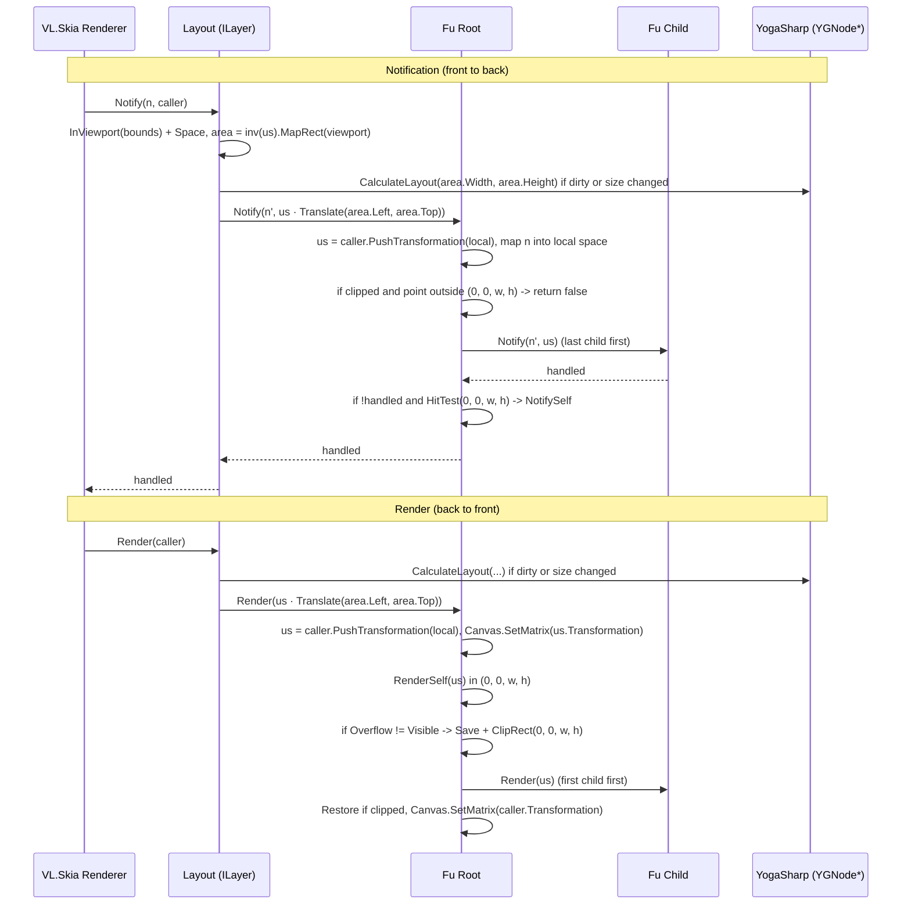

# Proposal: `Layout` Root & `Layoutable<TSelf>` (`Fu.Core`, `YogaSharp`, `VL.Core.Skia`)

> Code samples are guidance for the shape of the implementation, not code to copy.

## 1. Decisions

### 1.1 `Layout` root node

* `Layout` is a separate `ILayer`. It is **not** part of the Fu tree; it wraps exactly one Fu root (`Renderable` with `Parent is null`).
* It is modelled after VL.Skia's `InViewportUpstream`:
  * A `Bounds` pin in the **caller's space** (whatever space the renderer / downstream uses). When unset, the layout fills the caller's viewport.
  * On `Render` / `Notify` it maps its bounds to window pixels, opens a new viewport with `caller.InViewport(...)` and switches to its own space.
  * `ILayer.Bounds` returns the `Bounds` pin, in the caller's space.
* A `CommonSpace Space` pin selects the space Fu works in. Default: **`DIPTopLeft`**.
  * Units are the vvvv space units as they are: in `DIPTopLeft` **1 unit = 100 DIP** (`Padding = 0.08` is 8 DIP).
  * Yoga is top-left / y-down. For centred spaces (`Normalized`, `DIP`) the layout area is the viewport mapped back into the space, `inv(us.Transformation).MapRect(us.ViewportBounds)`, and the root is placed at that area's top-left, so the UI never starts in the middle of the window.
  * VL keeps `GetWithinCommonSpaceTransformation` `internal`. Fu either re-implements the few lines of scale/origin math in a small `Spaces` helper, or drives a cached `SetSpaceUpstream2` (`UpdateTransformation(...)` + `Transformation` are public).
* The `Layout` owns the layout trigger: it calls `CalculateLayout` on its root when the root is dirty or the available size changed.
* Notifications are mapped into the Fu space by a Fu-owned sender (`IWorldSpace2d`, `IProjectionSpace`), because VL's `IntermediateTransformNotificationSender` is `internal`.

### 1.2 Fu nodes without a `Layout`

* A Fu root that is rendered or notified without a `Layout` above it logs a warning through `NodeBase.Log` (no throw, the patch keeps running) and renders with its last computed layout, which is zero-sized until a `Layout` has laid it out.
* The `Layout` marks its root as hosted when it adopts it and clears the mark when the root is replaced or the `Layout` is disposed. That mark is what the root checks.

### 1.3 Yoga configuration

* Fu creates **one default `YGConfig*`** (`YGConfig.New()`, not Yoga's process-wide `YGConfig.GetDefault()`) once during assembly initialization. Every Fu node is created with it: `YGNode.New(DefaultConfig)`.
* Default settings:
  * `PointScaleFactor = 0`: Yoga does not round, which is required because a unit is 100 DIP (rounding to whole units would snap to 100 DIP steps).
  * `UseWebDefaults` is fixed by the default. Yoga hits a fatal assert when a node's config is replaced by one with a different `UseWebDefaults`, so overrides must not change it.
* A `Layout` may take **one override config**. When set, the `Layout` calls `SetConfig` on every node of its subtree; `Layoutable.OnChildrenChanged` gives newly added children their parent's config, so later additions follow.
* Pixel snapping (`PointScaleFactor` = pixels per unit of the Layout's space) is possible through the override, but not automatic yet.

### 1.4 Rectangles & transformations (minimal & compositional)

* **No extra `LocalBounds`, `ContentBounds` or `ScrollOffset` on `Layoutable<TSelf>`.**
* Two rectangles, both already present:
  1. **`Layout` (`ILayoutable.Layout`):** parent-relative `RectangleF(Left, Top, Width, Height)`, straight from Yoga.
  2. **`Bounds` (`ILayer.Bounds` on `Renderable`):** the node's local rectangle in its **parent's space**, following the VL.Skia convention (`TransformUpstream` returns `M.MapRect(Input.Bounds)`, without the caller's matrix). It is computed from `Layout` and `Transformation`, so it is always current and needs no render pass.
* One `Transformation` (`ILayoutable.Transformation`):
  * `Matrix` (Stride) is the VL-facing facade; Fu converts to and from `SKMatrix` with helpers (§ 3).
  * Rotation and scale pivot around the node's top-left (CSS defaults to the centre). A transform-origin is a possible later addition.
* **Scrolling is composition:** a clipped outer container whose child is a content container moved by its `Transformation` (§ 2).

---

## 2. `ILayoutable` & Scrolling

`ILayoutable` stays as it is in [Layoutable.cs](../../Fu.Core/Layout/Layoutable.cs):

```csharp
public interface ILayoutable
{
    RectangleF Layout { get; }
    Matrix Transformation { get; }
    void SetTransformation(Matrix transformation);
}
```

```text
ScrollViewport (Overflow = Hidden, fixed Width/Height)
  └── ScrollContent (children live here; Transformation = Translation(0, -scrollY, 0))
        ├── Item 1
        ├── Item 2
        └── Item 3
```

* `ScrollViewport` stays at its Yoga `Layout` and clips to `(0, 0, Layout.Width, Layout.Height)`.
* `ScrollContent` is a regular child whose `Transformation` is changed by a `Draggable` / `Scroll` behaviour. The scroll range is `ScrollContent.Layout.Height - ScrollViewport.Layout.Height`.
* Yoga never recalculates layout while scrolling, since only a `Transformation` changes.
* The clip must also apply to notifications (§ 5), otherwise a scrolled-out item still catches clicks.

---

## 3. Transform Composition & `Bounds`

* Local-to-parent transform, applying `Transformation` first and then moving into the Yoga slot:

  ```csharp
  // Skia (column vectors)
  SKMatrix local = SKMatrix.CreateTranslation(Layout.X, Layout.Y).PreConcat(Transformation.ToSKMatrix());
  // Stride (row vectors), same transform
  Matrix local = Transformation * Matrix.Translation(Layout.X, Layout.Y, 0);
  ```

* World transforms are never stored. Each node pushes `local` onto the `CallerInfo` (`caller.PushTransformation(local)`), as `TransformUpstream` does.
* `Bounds`:

  ```csharp
  public RectangleF? Bounds
  {
      get
      {
          var r = LocalTransformation.MapRect(new SKRect(0, 0, Layout.Width, Layout.Height));
          return new RectangleF(r.Left, r.Top, r.Width, r.Height);
      }
  }
  ```

  Dragging a node (`SetTransformation`) leaves `Layout` (its Yoga slot) unchanged and moves `Bounds`.
* Conversion helpers (`Matrix` is a facade; Z, rotation around X/Y and the 3rd row/column are dropped):

  ```csharp
  // Stride: x' = x*M11 + y*M21 + M41   Skia: x' = ScaleX*x + SkewX*y + TransX
  public static SKMatrix ToSKMatrix(this Matrix m) =>
      new(m.M11, m.M21, m.M41,
          m.M12, m.M22, m.M42,
          m.M14, m.M24, m.M44);

  public static Matrix ToMatrix(this SKMatrix m) =>
      new(m.ScaleX, m.SkewY, 0, m.Persp0,
          m.SkewX, m.ScaleY, 0, m.Persp1,
          0, 0, 1, 0,
          m.TransX, m.TransY, 0, m.Persp2);
  ```

---

## 4. Layout Calculation (`Layoutable<TSelf>`)

### 4.1 `CalculateLayout` (roots only)

```csharp
public unsafe void CalculateLayout(
    float availableWidth = float.NaN,
    float availableHeight = float.NaN,
    YGDirection direction = YGDirection.LTR)
{
    if (_handle is null)
        return;

    if (Parent is not null)
    {
        // Yoga would lay this subtree out as if it were a root and overwrite the parent's results.
        Log(LogLevel.Warning, "Only a root element can calculate layout; it is calculated by its Layout.");
        return;
    }

    _handle->CalculateLayout(availableWidth, availableHeight, direction);

    if (_handle->GetHasNewLayout())
        ApplyLayout();
}
```

### 4.2 `ApplyLayout` chain

Top-down from the root, as before, but without passing the parent's layout: Yoga positions are already parent-relative and `Bounds` is in the parent's space.

```csharp
private unsafe void ApplyLayout()
{
    ReadLayout();
    _handle->SetHasNewLayout(false);

    foreach (var child in Children)
    {
        if (child._handle->GetHasNewLayout())
            child.ApplyLayout();
        else
            child.ReadLayout(); // Yoga can move a child while reusing its cached size, without flagging it
    }
}

private unsafe void ReadLayout()
{
    var layout = new RectangleF(
        _handle->GetComputedLeft(),
        _handle->GetComputedTop(),
        _handle->GetComputedWidth(),
        _handle->GetComputedHeight());

    if (layout == _layout)
        return;

    _layout = layout;
    OnLayoutChanged(layout);
}

protected virtual void OnLayoutChanged(RectangleF layout) { }
```

The "position changes without `HasNewLayout`" case gets a unit test before relying on the pruning.

### 4.3 Trigger in `Layout`

* Recalculate when `root.IsDirty()` or the available size changed.
* Compare sizes NaN-safely (`a.Equals(b)`, not `a == b`); an unconstrained `NaN` size is otherwise never equal to itself and layout runs every frame.

---

## 5. Frame Pipeline (`Layout` → `Layoutable` → `Interactable` → `Renderable`)



* Transforms follow VL.Skia: `Canvas.SetMatrix` and restore the caller's matrix afterwards; `Save` / `Restore` only for clipping.
* Dragging (including `ScrollContent`) needs pointer capture: once a press is handled, moves and the release go to the capturing node even outside its bounds. Details belong to the gesture proposal.
* Like `InViewportUpstream`, a `Layout` under a rotated transform lays out in the axis-aligned pixel rectangle of its bounds.

### Responsibilities

| Layer | Responsibility | Members |
| :--- | :--- | :--- |
| **`Layout`** | `ILayer` host for one Fu root. Bounds in caller space, `CommonSpace` (default `DIPTopLeft`), optional config override, layout trigger, notification mapping. | `Bounds`, `Space`, `Config`, `Root`, `Render`, `Notify` |
| **`Layoutable<TSelf>`** | Owns `YGNode*` (created with the Fu default config), syncs the Yoga tree and config in `OnChildrenChanged`, `CalculateLayout` on roots, `ApplyLayout` chain, parent-relative `Layout`, local `Transformation`. | `Layout`, `Transformation`, `SetTransformation`, `CalculateLayout`, `OnLayoutChanged` |
| **`Interactable<TSelf>`** | Pushes the local transform, maps notifications into local space, respects clipping, routes to children last-first, hit-tests `(0, 0, w, h)`. | `Notify`, `NotifySelf` |
| **`Renderable`** | `Bounds` in parent space, `RenderSelf` in `(0, 0, w, h)`, clipping, children first-first. Warns when rendered without a `Layout`. | `Bounds`, `Render`, `RenderSelf` |

---

## 6. Out of Scope

* **Measure functions** (intrinsic sizing for text, images, wrapped `ILayer`s). Hard to set up from a patch; revisit with text rendering. When added: one static `[UnmanagedCallersOnly]` callback resolving the node through `GetContext`, and a guard, because Yoga asserts fatally on a node with both a measure function and children.
* **Automatic pixel snapping** from the Layout's space.
* **Transform origin** for `Transformation`.
