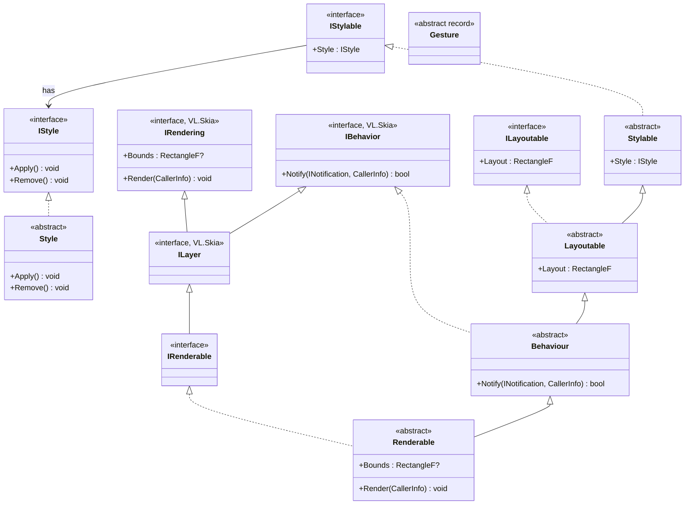
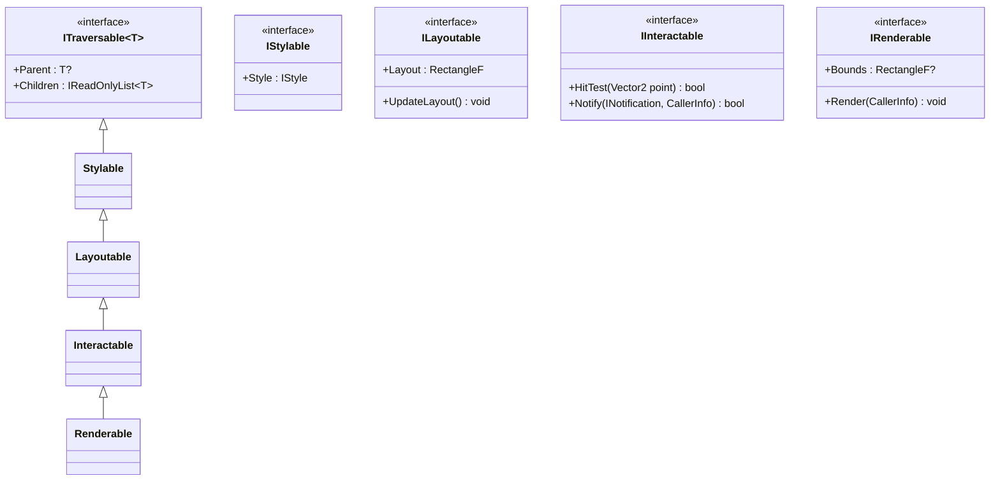

# `Fu.Core` Inheritance Chain & Semantic Analysis

## 1. Current Inheritance Chain

Currently, `Fu.Core` defines a strict linear inheritance hierarchy where each capability layer inherits from the one above it, alongside two standalone types (`Style` and `Gesture`).

### Mermaid Class Diagram



### Linear Chain Summary

```text
Stylable (IStylable)
  └── Layoutable (ILayoutable)
        └── Behaviour (VL.Skia.IBehavior)
              └── Renderable (IRenderable : VL.Skia.ILayer)
```

**Standalone / Supporting Types:**
* `Style : IStyle` (`Fu.Core.Style`)
* `Gesture` (`abstract record` in `Fu.Core.Interaction`)
* `Traversable\` (Empty folder referenced in `Fu.Core.csproj` — signals planned tree/graph traversal)

---

## 2. Semantic & Architectural Reasoning: What's Missing or Questionable?

Because `Fu` is a **functional UI library for vvvv VL** (backed by `antokhio.YogaSharp` for layout and `VL.Core.Skia` for rendering/notifications), the core semantics need to reconcile **VL's dataflow paradigm** (immutable descriptors vs. stateful node instances, Spectral/Spread inputs, `CallerInfo` propagation) with **UI tree passes** (Style resolution -> Yoga Measure/Layout -> Hit-testing/Interaction -> Skia Render).

Here are the key semantic gaps and design questions in the current hierarchy:

### A. Tree Structure & Traversal (`ITraversable` / `UIElement` / Hierarchy)
`Fu.Core.csproj` has a `<Folder Include="Traversable\" />`, which is currently empty, and nothing in the chain knows about **parent/child relationships**.
* **Where does `Traversable` sit in the chain?**
  * UI elements form a tree (Yoga requires a node tree to compute layout; `Renderable` needs to render children; `Behaviour` needs to route/bubble notifications to children).
  * If `Traversable` is the root (above `Stylable`), then styles can cascade down the tree, Yoga can sync the tree structure, notifications can tunnel/bubble, and rendering can traverse front-to-back / back-to-front.
  * **Proposed root:** `Traversable` (or `Element` / `FuNode`) $\rightarrow$ `Stylable` $\rightarrow$ `Layoutable` $\rightarrow$ `Behaviour` $\rightarrow$ `Renderable`.

### B. Deep Inheritance vs. Composition ("Is-A" vs. "Has-A")
Right now the chain says: *A `Renderable` **is a** `Behaviour`, which **is a** `Layoutable`, which **is a** `Stylable`.*
* **Naming / Semantic friction with `Behaviour`:**
  * In UI frameworks (and VL.Skia), a "Behaviour" usually means an **attached interaction logic** (e.g., `DragBehaviour`, `ClickBehaviour`, `HoverBehaviour`), not a base class for visual widgets.
  * Having `Behaviour : Layoutable` and `Renderable : Behaviour` means a `Behaviour` *is* a layout box with a style, and a `Renderable` *is* a single behaviour.
  * **Alternative 1 (Rename the layer):** If the class is meant to be an interactive UI element in the chain, naming it `Interactable` (which *has* one or more `IBehavior`s or `Gesture` recognizers) reads much cleaner:
    `Traversable -> Stylable -> Layoutable -> Interactable -> Renderable`.
  * **Alternative 2 (Composable Behaviours):** An element can have multiple behaviours attached (e.g. a slider or draggable panel). If `Interactable` holds a collection of `IBehavior` / gesture handlers, you don't need subclassing for every interaction combination.

### C. Yoga Layout Lifecycle (`ILayoutable`)
`ILayoutable` currently only exposes the *output* of layout: `RectangleF Layout { get; }`.
* **Input vs. Output:** How does Yoga know the constraints? Are Yoga layout properties (Flex, Margin, Padding, Width, Height, FlexDirection) part of `IStyle`, or part of `ILayoutable` (`YGNode`)?
* **Two-Pass Layout (Prepare/Measure vs. Arrange/Read):**
  * Yoga requires building/updating the `YGNode` tree, calling `YGNodeCalculateLayout`, and then reading back the computed `Layout` (`Left`, `Top`, `Width`, `Height`).
  * Also, leaf nodes like **Text** or **Images** need a custom `MeasureFunc` (asking Skia `SKPaint` how big a string is before Yoga finishes layout).
  * **Missing semantics:** `ILayoutable` likely needs a way to bind/update its `YGNode` and synchronize its computed `RectangleF` (local vs. world/screen space coordinates for hit-testing).

### D. Styling Semantics (`IStyle` & `IStylable`)
Currently `IStyle` has `void Apply()` and `void Remove()` with no parameters.
* **Target of `Apply()`:** What is `Style` applying itself to?
  * Does it apply to a `YGNode` (layout styles: padding, flex, size)?
  * Does it apply to an `SKPaint` / rendering context (visual styles: fill, stroke, corner radius, font, shadow)?
  * Or does `Apply(TContext)` / `Apply(Stylable target)` mutate/configure the element?
* **State-driven Styling (Pseudo-states):**
  * In UI, style depends on interaction state (`Hovered`, `Pressed`, `Focused`, `Disabled`, `Active`).
  * If `Stylable` is at the top of the chain and `Behaviour` (interaction) is near the bottom, how does `Stylable` know the current interaction state when resolving styles? Either `Style` resolution happens as a pass *after* interaction state is updated, or `Style` is evaluated with an `InteractionState` / `StyleContext`.

### E. Interaction, Hit-Testing, and `Gesture`
Currently `Behaviour` implements `VL.Skia.IBehavior` (`bool Notify(INotification, CallerInfo)`) and `Gesture` is an empty `abstract record`.
* **Bridge between `INotification` and `Gesture`:**
  * `VL.Skia` sends raw stream notifications (`MouseDown`, `MouseMove`, `MouseUp`, `KeyDown`, `Touch`).
  * A functional UI library benefits hugely from lifting raw `INotification` events into high-level immutable `Gesture` records (`Clicked`, `Dragged(delta)`, `Hovered`, `Scrolled`, `Focused`) that VL patches can easily match or observe.
* **Hit-Testing & Coordinate Spaces:**
  * To handle `Notify`, a node needs to know if the mouse position (in `CallerInfo` / notification space) is inside its `Layout` bounds (or clip region), and transform coordinates into local space for children.
  * **Focus & Capture:** When dragging a slider, the active element must *capture* pointer notifications even when the cursor leaves its `Layout` `RectangleF`. A central or root `InteractionContext` / `FocusManager` is usually needed at the root of the UI tree.

### F. Rendering vs. Layout Bounds (`Renderable`)
`Renderable` has both:
* `RectangleF Layout` (inherited from `Layoutable`)
* `RectangleF? Bounds` (from `VL.Skia.IRendering`)
* **Semantic distinction:** This is actually a great distinction if intentional:
  * `Layout` = the box Yoga allocated for this element.
  * `Bounds` = the actual visual bounding box (which might be larger due to drop shadows, outlines, or unclipped overflow, or `Layout` by default).
  * In `Renderable`, `Bounds => Layout;` is a natural default implementation.

### G. Functional / VL Paradigm: Identity & State Management
Since `Fu` stands for **Functional UI** in VL:
* **Immediate / Declarative vs. Retained State:**
  * In VL, users might reconstruct descriptors every frame (or on change), OR each UI widget is a stateful Process Node that outputs an `IRenderable` / `Element`.
  * If nodes are functional/declarative, elements need a stable **Identity / Key** (`Id`) to preserve state (hover, focus, animation, Yoga node handle) across frames.
  * **Resource Cleanup (`IDisposable`):** `YGNode` wraps native unmanaged Yoga memory (`antokhio.YogaSharp`), and `SKPaint`/`SKImage`/`SKPicture` wrap native Skia resources. Something in the chain (or the backing retained node) needs `IDisposable` semantics.

---

## 3. Suggested Refined Architecture to Consider

If keeping the layered inheritance approach for convenience in VL (so any widget pin can be treated as `IRenderable`, `ILayoutable`, `IStylable`, etc.), consider this refined mental model:



### Summary Checklist of What's Missing Next
1. **`Traversable` / Tree Hierarchy:** Parent/Children links (and deciding whether `Traversable` is the base of `Stylable`).
2. **Coordinate Space & Transform:** Local `Layout` (relative to parent) vs. Global/Canvas `Layout` (needed for Skia drawing and mouse hit-testing).
3. **Tree Update Passes:** Clear separation of frame passes at the root container (e.g., `FuRoot` / `Canvas`):
   1. **Style Pass** (resolve styles + interaction pseudo-states)
   2. **Layout Pass** (sync to Yoga, calculate layout, read back `RectangleF`)
   3. **Notification Pass** (hit-test, update `Gesture` states, bubble/capture events)
   4. **Render Pass** (apply transforms/clipping, draw via `VL.Skia.CallerInfo`)
4. **`IDisposable`:** Managing `YogaSharp` native handles and Skia resources cleanly.
