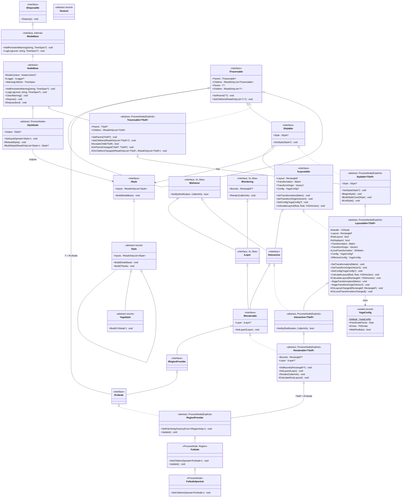

# `VL.Fu.Core` Inheritance Chain & Architectural Summary

## 1. Current Inheritance Chain

`VL.Fu.Core` uses a **Curiously Recurring Template Pattern (CRTP)** (`TSelf`) layered inheritance hierarchy rooted in `NodeBase` and `Traversable<TSelf>`, continued through `Stylable<TSelf>`, `Layoutable<TSelf>`, `Interactive<TSelf>`, and `Renderable<TSelf>`, and closed at `RegionProvider` (`RegionProvider : Renderable<IFuNode>, IFuNode`). This gives every layer strongly-typed `Parent` and `IReadOnlyList<IFuNode> Children` without casting (stored internally as `Spread<IFuNode>`), while also exposing a parallel chain of non-generic interfaces (`ITraversable` → `IStylable` → `ILayoutable` → `IInteractive` → `IRenderable` → `IRegionProvider` → `IFuNode`) for untyped inspection and VL patching.

### Mermaid Class Diagram



### Linear Chain Summary

```text
NodeBase (INodeBase : IDisposable)                                        [VL.Fu.Core.Base]
  └── Traversable<TSelf> (ITraversable<TSelf> : ITraversable)              [VL.Fu.Core.Tree]
        └── Stylable<TSelf> (IStylable : ITraversable)                     [VL.Fu.Core.Styling]
              └── Layoutable<TSelf> (ILayoutable : IStylable)              [VL.Fu.Core.Layout]
                    └── Interactive<TSelf> (IInteractive : ILayoutable, IBehavior) [VL.Fu.Core.Interaction]
                          └── Renderable<TSelf> (IRenderable : IInteractive, ILayer) [VL.Fu.Core.Rendering]
                                └── RegionProvider (IFuNode : IRegionProvider, ITraversable<IFuNode>) [VL.Fu.Core.Region] (closes TSelf = IFuNode)
                                      └── FuNode                           [VL.Fu] (concrete ProcessNode with PinGroup Children)
                                            └── FuNodeSpectral             [VL.Fu] (concrete ProcessNode with Spread<IFuNode> Children)
```

**Supporting / Standalone Types:**
* `Initializer` (`VL.Fu.Core`) — `AssemblyInitializer<Initializer>`
* `NodeBaseExtensions` (`VL.Fu.Core.Base`) — `LogInfo()`, `LogWarning()`, `LogError()`
* `PinOrder` (`VL.Fu.Core.Constants`) — internal pin order constants (`Children = -100`, `Style = -50`, `Transform = 0`, `Behavior = 25`, `Debug = 50`, `Enabled = 100`)
* `TraversableExtensions` (`VL.Fu.Core.Tree`) — `Root()`, `Ancestors()`, `Descendants()`, `IsAncestorOf()`
* Concrete style records in `VL.Fu.Core.Styles` (`WidthStyle`, `HeightStyle`, `SizeStyle`, `GapStyle`, `TransformStyle` and `TransformOriginStyle` (`: Style<IFuNode>`), the flex and align records (`FlexDirectionStyle`, `FlexWrapStyle`, `FlexGrowStyle`, `FlexShrinkStyle`, `FlexBasisStyle`, `JustifyContentStyle`, `AlignItemsStyle`, `AlignSelfStyle`, `AlignContentStyle`), the edge records (`PaddingStyle`, `MarginStyle`, `BorderStyle` for one `YGEdge`, and their `LRTB` variants), `MinWidthStyle`, `MaxWidthStyle`, `MinHeightStyle`, `MaxHeightStyle`, `AspectRatioStyle`, the position and display records (`PositionTypeStyle`, `PositionStyle`, `DisplayStyle`, `OverflowStyle`, `DirectionStyle`, `BoxSizingStyle`), plus `YogaValues.Ratio`, where `1` is the whole parent, and internal `YogaDimension`, `YogaEnums`, `YogaEdges`); style process nodes in `VL.Fu.Styles` (`CombineNode`, `SetWidthNode`, `SetWidthRatioNode`, `SetWidthAutoNode`, the obsolete `SetWidthPercentNode`, `SetHeightNode`, `SetHeightRatioNode`, `SetHeightAutoNode`, `SetSizeNode`, `SetSizeRatioNode`, `SetSizeAutoNode`, `GapStyleNode`, `SetGapNode`, `SetRowGapNode`, `SetColumnGapNode`, `SetTransformNode` and `SetTransformOriginNode` in `TransformNodes.cs`, the flex and align setters in `FlexNodes.cs` and `AlignNodes.cs`, `EdgesStyleNode` with the padding, margin and border nodes in five shapes each (edge pin, Uniform, Horizontal, Vertical, LRTB), min/max size nodes with `(Ratio)` variants, `AspectRatioStyleNode` with `SetAspectRatioNode`, `SetAspectRatioVector2Node`, `SetAspectRatioInt2Node`, `SetPositionTypeNode`, `SetPositionXNode`, `SetPositionYNode`, `SetPositionNode`, `SetDisplayNode`, `SetOverflowNode`, `SetDirectionNode`, `SetBoxSizingNode`). See [proposal-style-instructions.md](../proposals/proposal-style-instructions.md)
* `YogaConfig`, `YogaConfigCache`, `YogaStyleStage` (`VL.Fu.Core.Layout`). See [proposal-layoutable.md](../proposals/proposal-layoutable.md)
* `MatrixExtensions` (`VL.Fu.Core.Extensions`) — `ToSKMatrix()`, `ToMatrix()` conversions between Stride `Matrix` and Skia `SKMatrix`
* `Gesture` (`abstract record` in `VL.Fu.Core.Interaction`)

---

## 2. What Is Already Solved by the Current Layers

### A. `NodeBase` (`VL.Fu.Core.Base`)
* **VL Node Diagnostics & Lifecycle:** Accepts hidden `NodeContext`, exposes `ILogger`, and manages visual node warnings directly in the vvvv patch (`AddPersistentWarning`, `Log`, `ClearWarning`, plus `NodeBaseExtensions`) with automatic deduplication and async expiration timers (`DefaultWarningLifetime = 10s`).
* **Resource Management:** Implements `IDisposable` with virtual `Dispose(bool disposing)` so derived layers (like Yoga native handles in `Layoutable`, patch inlays in `RegionProvider`, or Skia resources in `Renderable`) have a standard cleanup hook.

### B. `Traversable<TSelf>` (`VL.Fu.Core.Tree`)
* **Dual Generic + Non-Generic Contract (Interface-Capable CRTP):**
  * `ITraversable<TSelf>` exposes `TSelf? Parent` and `IReadOnlyList<TSelf> Children` on the public facade while storing `Spread<TSelf>` internally (preserving passed-in VL `Spread<T>` instances without copying). Deliberately does not implement `IEnumerable<TSelf>` so VL does not offer sequence operations on a node directly.
  * `ITraversable` (`[Name("Traversable (Ungeneric)")]`) exposes read-only untyped `ITraversable? Parent` and `IReadOnlyList<ITraversable> Children`, and forms the base of the non-generic interface chain (`IStylable`, `ILayoutable`, `IInteractive`, `IRenderable`, `IRegionProvider`, `IFuNode`).
  * `TSelf` can be an interface (such as `IFuNode`): `AcceptsChild(TSelf)` guards that only nodes actually deriving from `Traversable<TSelf>` (and `Layoutable<TSelf>`) can join the tree, rejecting foreign implementations with a warning.
* **Self-Healing Tree Integrity:**
  * `SetChildren` and `SetParent` keep bidirectional parent/child pointers strictly synchronized.
  * `Sanitize` filters out `null` children, foreign interface implementations (`!AcceptsChild`), duplicate references, self-cycles, and ancestor cycles—reporting patch wiring mistakes via `NodeBase.Log(LogLevel.Warning, ...)` instead of crashing the VL runtime.
* **Lifecycle Hooks for Subclasses:**
  * `OnParentChanged(TSelf? oldParent, TSelf? newParent)` and `OnChildrenChanged(IReadOnlyList<TSelf> oldChildren, IReadOnlyList<TSelf> newChildren)` allow `Layoutable<TSelf>` to attach/detach `YGNode` children and propagate inherited config automatically when the tree changes.
* **Allocation-Friendly Traversal:**
  * `TraversableExtensions` provides `Root()`, `Ancestors()`, `IsAncestorOf()`, and an iterative stack-based pre-order `Descendants()`.

### C. `Stylable<TSelf>`, `IStyle` / `Style`, and `StyleNode` (`VL.Fu.Core.Styling`)
* **Immutable Style Tree (`IStyle` & `Style`):**
  * Pins are typed as `IStyle` (`IReadOnlyList<IStyle> Inputs`, `Build(NodeBase)`) since vvvv cannot compile a pin group of a record type.
  * `Style` (`: IStyle`) records form a DAG of instructions (`IReadOnlyList<IStyle> Inputs`), evaluated depth-first left-to-right so later instructions override earlier ones, with structural value equality across `Inputs` (and `CombinedStyle` for multi-input pass-through).
  * `Style<TNode>` (`where TNode : class`) targets properties on a specific node class or interface (such as `TransformStyle : Style<IFuNode>`); `YogaStyle` targets native `YGNode*` styles.
* **Staged Styling Pass (`Stylable<TSelf>`):**
  * `SetStyle(IStyle?)` (`[Fragment(Order = PinOrder.Style)]`) short-circuits on reference equality. When changed, it runs `BeginStyle()` (reset staged values to defaults), walks the `IStyle` tree via `BuildStyleCore(IStyle)` (catching and logging incompatible style exceptions as node warnings), and commits diffs in `EndStyle()`.
* **Patch Caching (`StyleNode`):**
  * Base `[ProcessNode]` for all style setter nodes; accepts `Spread<IStyle>` via `SetInput`, caches `IStyle? Output`, and rebuilds only when inputs or pin values change, validating finite floats/vectors/matrices (`ValidateFinite`, `ValidateNonNegative`) and enums (`ValidateEnum`), and eliding no-op setters.

### D. `Layoutable<TSelf>` and `YogaConfig` (`VL.Fu.Core.Layout`)
* **Native Yoga Node Lifecycle:**
  * Owns a native `YGNode*` (`Handle`), exposes `IsDisplayed` (`_handle->GetDisplay() != YGDisplay.None`), restricts `AcceptsChild` to `Layoutable<TSelf>`, mirrors `Children` into Yoga inside `OnChildrenChanged`, and detaches + disposes the native handle and config reference in `Dispose(bool)`.
* **Scratch Style Staging (`YogaStyleStage`):**
  * During `BeginStyle()`, resets a thread-local scratch `YGNode*` from a pristine template (`UseWebDefaults = true`); `BuildStyleCore` applies all `YogaStyle` instructions to the stage, and `EndStyle()` calls `_handle->CopyStyle(YogaStyleStage.Node)` once so Yoga only marks the node dirty if the effective style changed.
* **Inherited `YogaConfig` (`YogaConfigCache`):**
  * `Config` / `SetConfig(YogaConfig?)` (`[Fragment(Order = PinOrder.Debug)]`, `PinVisibility.Optional`) can be set on any node and cascades down to descendants without an explicit config via `OnParentChanged`, backed by a reference-counted native `YGConfig*` cache (`YogaConfig.Default` has `PointScaleFactor = 0f`, `Errata = YGErrata.None`, `WebFlexBasis = true`).
* **Layout Pass & Local Transformations:**
  * `CalculateLayout` runs on root nodes (`Parent is null`; logs a warning if called on a child), supports laying out into a caller-space `RectangleF area` (`_origin` offset on the root, cleared when attached to a parent), and walks the tree top-down (`ApplyLayout` / `ReadLayout`), updating parent-relative `Layout` (`RectangleF`), setting `HasLayout = true`, and invoking `OnLayoutChanged(oldLayout, newLayout)`.
  * Maintains visual `Transformation` (`Stride.Core.Mathematics.Matrix`, settable directly via `[Fragment(Order = PinOrder.Transform)] SetTransformation` or staged via `StageTransformation` / `TransformStyle`) with its `TransformOrigin` (`Vector2`, `(0, 0)` the centre, `±1` the edges; `SetTransformOrigin` or staged via `StageTransformOrigin` / `TransformOriginStyle`), and precomputes `LocalTransformation` (`SKMatrix`: `Translate(_origin.X + Layout.X + pivot.X, _origin.Y + Layout.Y + pivot.Y) · Transformation · Translate(-pivot)`, pivot from `TransformOrigin` and the layout size), firing `OnLocalTransformationChanged()`.

### E. `Renderable<TSelf>` (`VL.Fu.Core.Rendering`), `RegionProvider` (`VL.Fu.Core.Region`), and `FuNode` (`VL.Fu`)
* **Bounds, Viewport Layout & Tree Rendering (`Renderable<TSelf>`):**
  * `Renderable<TSelf>.Bounds` (`RectangleF?`) returns explicit bounds set via `SetBounds(RectangleF?)` if provided; otherwise stays `null` until the node has been laid out (`HasLayout`), and is automatically updated in `OnLocalTransformationChanged()` by mapping `(0, 0, Layout.Width, Layout.Height)` through `LocalTransformation`.
  * `Renderable<TSelf>.Layer` / `SetLayer(ILayer)` stores the visual Skia layer produced for the node.
  * `Renderable<TSelf>.Render(CallerInfo caller)` captures the caller's viewport area in caller space on roots (`CaptureViewportArea`), skips rendering when `!HasLayout || !IsDisplayed`, pushes `LocalTransformation` onto both `caller.Canvas` and `CallerInfo.Transformation`, renders `Layer`, renders `Children` in forward order, and restores the canvas state.
  * `CalculateRootLayout()` lays a root out into `_explicitBounds ?? _viewportArea` (following the window one frame later when no explicit bounds are set).
* **Closing the Chain at `IFuNode` (`RegionProvider`, `FuNode`, `FuNodeSpectral`):**
  * All generic layers (`Traversable<TSelf>` through `Renderable<TSelf>`) and `RegionProvider` carry `[ProcessNode(FragmentSelection = FragmentSelection.Explicit)]` so only `[Fragment]`-marked methods (`SetStyle`, `SetTransformation`, `SetConfig`, `Update`, `SetChildren`) become process-node pins, ordered via `PinOrder`.
  * `RegionProvider` closes the CRTP chain at `IFuNode` (`RegionProvider : Renderable<IFuNode>, IFuNode`), implements `IRegion<IRegionProvider.IRegionInlay>` (`Update(IFuNode node, RectangleF bounds, out ILayer layer)`, where `bounds` is the node's box in its own space, `(0, 0, Layout.Width, Layout.Height)`), forwards the inlay's `ILayer` output to `SetLayer(layer)` on `Update()`, and disposes the inlay (if `IDisposable`) and clears control-point dictionaries in `Dispose(bool)`.
  * `FuNode` (`[ProcessNode(Name = "FuNode", HasStateOutput = true)]`, `[Region(SupportedBorderControlPoints = ControlPointType.None)]`) exposes `Children` as a collection pin group (`Spread<IFuNode>`) and overrides `Update()` to run `base.Update()` followed by `CalculateRootLayout()`, while `FuNodeSpectral` (`[ProcessNode(Name = "FuNode (Spectral)", HasStateOutput = true)]`) exposes `Children` as a single `Spread<IFuNode>` pin.

---

## 3. Remaining Semantic & Architectural Questions (Next Layers)

With `NodeBase`, `Traversable<TSelf>`, `Stylable<TSelf>`, `Layoutable<TSelf>`, `Renderable<TSelf>`, `RegionProvider`, and `FuNode` in place, the remaining work and open questions center on `Interactive<TSelf>`, overflow clipping in `Renderable<TSelf>.Render`, and advanced styling/layout features:

### A. Styling Extensions (`Stylable<TSelf>`)
* **State-Driven Styling (Pseudo-states):**
  * Visual and layout styles often depend on interaction state (`Hovered`, `Pressed`, `Focused`, `Disabled`) which lives lower in `Interactive<TSelf>`.
  * Either `Stylable<TSelf>` exposes a style rule that gets evaluated with the current interaction state during the update/render pass, or `Interactive<TSelf>` notifies `Stylable<TSelf>` when pseudo-states change.

### B. Yoga Layout Extensions (`Layoutable<TSelf>`)
* **Custom Measure (`MeasureFunc`):**
  * Leaf elements (text, icons, intrinsic images) will eventually need to measure their content via Skia before Yoga computes layout (with a guard ensuring nodes with a `MeasureFunc` cannot have children).
* **Automatic Pixel Snapping:**
  * Optional automatic `PointScaleFactor` derived from the caller's space.

### C. Interaction, Hit-Testing, and `Gesture` (`Interactive<TSelf>`)
`Interactive<TSelf>.Notify(INotification, CallerInfo)` currently returns `false` (stub), and `Gesture` is an empty abstract record. Per [proposal-layoutable.md](../proposals/proposal-layoutable.md):
* **Root Layout Trigger & Space Mapping:**
  * When `Parent is null`, `Notify` should push the local transformation and map notifications into local space.
* **Routing Notifications Through `Children`:**
  * In `Notify`, notifications should respect `IsDisplayed` and clipping (`Overflow != Visible`) and be routed to `Children` in **reverse paint order** (front-to-back, i.e., `for (int i = Children.Count - 1; i >= 0; i--)`), stopping when a child returns `true` (handled).
* **Hit-Testing & Pointer Capture:**
  * Pointer notifications (`MouseNotification`, `TouchNotification`) need a local `HitTest` check against `(0, 0, Layout.Width, Layout.Height)` (and clipping bounds).
* **Bridging `INotification` to `Gesture`:**
  * Active gestures (like dragging a slider or scrollbar) need **pointer capture** so the element continues receiving move/up notifications even when the cursor leaves its bounds.
  * `Interactive<TSelf>` can translate raw `INotification` events into high-level `Gesture` records (`Hover`, `Click`, `Drag`, `Scroll`, `Focus`) or allow attaching composable gesture recognizers.

### D. Overflow Clipping in Rendering (`Renderable<TSelf>`)
`Renderable<TSelf>.Render(CallerInfo caller)` already handles viewport capture, `HasLayout` / `IsDisplayed` guards, `LocalTransformation` concatenation, `Layer` rendering, and child traversal. Remaining rendering work:
* **Overflow Clipping:**
  * Apply clipping (`canvas.ClipRect`) in `(0, 0, Layout.Width, Layout.Height)` when `Overflow != Visible` before rendering children (or content).

