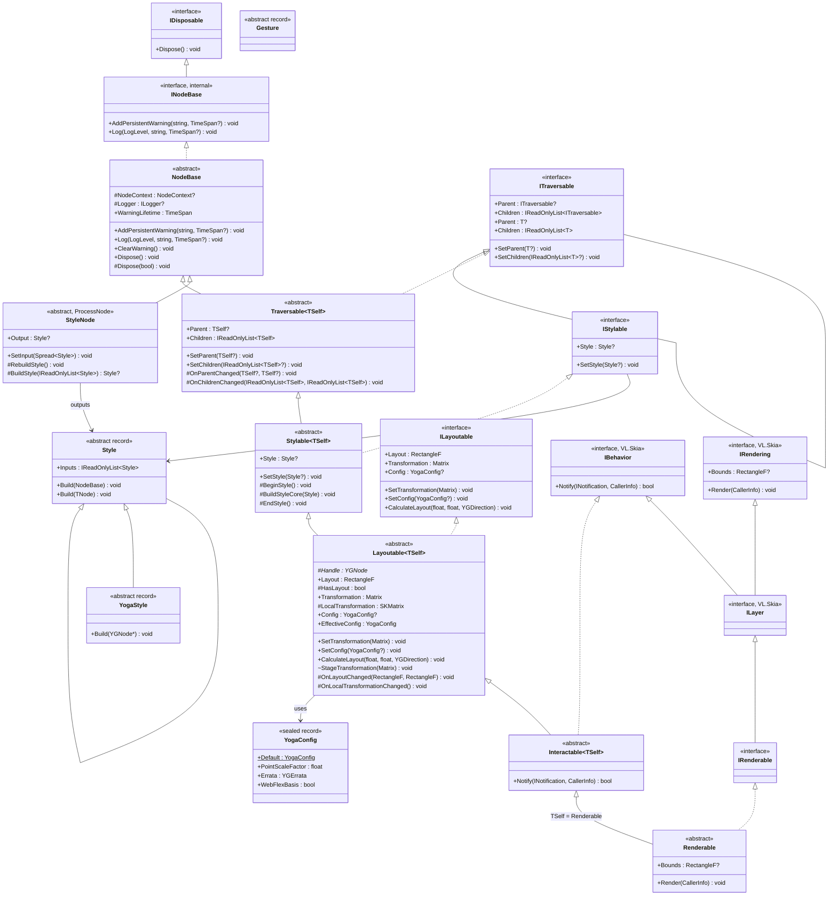

# `Fu.Core` Inheritance Chain & Architectural Summary

## 1. Current Inheritance Chain

`Fu.Core` uses a **Curiously Recurring Template Pattern (CRTP)** (`TSelf`) layered inheritance hierarchy rooted in `NodeBase` and `Traversable<TSelf>`, and closed at `Renderable` (`Renderable : Interactable<Renderable>`). This gives every layer strongly-typed `Parent` and `IReadOnlyList<Renderable> Children` without casting (stored internally as `Spread<Renderable>`), while still exposing non-generic interfaces (`ITraversable`, `IStylable`, `ILayoutable`, `IBehavior`, `IRenderable`) for untyped inspection and VL patching.

### Mermaid Class Diagram



### Linear Chain Summary

```text
NodeBase (INodeBase : IDisposable)                           [Fu.Core.Base]
  └── Traversable<TSelf> (ITraversable<TSelf> : ITraversable) [Fu.Core.Tree]
        └── Stylable<TSelf> (IStylable)                       [Fu.Core.Styling]
              └── Layoutable<TSelf> (ILayoutable)             [Fu.Core.Layout]
                    └── Interactable<TSelf> (VL.Skia.IBehavior) [Fu.Core.Interaction]
                          └── Renderable (IRenderable : ILayer) [Fu.Core.Rendering] (closes TSelf = Renderable)
                                └── FuNode                      [VL.Fu] (concrete ProcessNode)
```

**Supporting / Standalone Types:**
* `NodeBaseExtensions` (`Fu.Core.Base`) — `LogInfo()`, `LogWarning()`, `LogError()`
* `TraversableExtensions` (`Fu.Core.Tree`) — `Root()`, `Ancestors()`, `Descendants()`, `IsAncestorOf()`
* `Style`, `Style<TNode>`, `YogaStyle`, `CombinedStyle` (immutable records) and the `StyleNode` base (`Fu.Core.Styling`); concrete style records in `Fu.Core.Styles` (`WidthStyle`, `GapStyle`, `TransformStyle`); style process nodes in `VL.Fu.Styles` (`SetWidthNode`, `SetWidthPercentNode`, `SetWidthAutoNode`, `SetGapNode`, `SetRowGapNode`, `SetColumnGapNode`, `SetTransformNode`, `CombineNode`). See [proposal-style-instructions.md](../proposals/proposal-style-instructions.md)
* `YogaConfig`, `YogaConfigCache`, `YogaStyleStage` (`Fu.Core.Layout`). See [proposal-layoutable.md](../proposals/proposal-layoutable.md)
* `MatrixExtensions` (`Fu.Core.Extensions`) — `ToSKMatrix()`, `ToMatrix()` conversions between Stride `Matrix` and Skia `SKMatrix`
* `Gesture` (`abstract record` in `Fu.Core.Interaction`)

---

## 2. What Is Already Solved by the Current Layers

### A. `NodeBase` (`Fu.Core.Base`)
* **VL Node Diagnostics & Lifecycle:** Accepts hidden `NodeContext`, exposes `ILogger`, and manages visual node warnings directly in the vvvv patch (`AddPersistentWarning`, `Log`, `ClearWarning`, plus `NodeBaseExtensions`) with automatic deduplication and async expiration timers (`DefaultWarningLifetime = 10s`).
* **Resource Management:** Implements `IDisposable` with virtual `Dispose(bool disposing)` so derived layers (like Yoga native handles in `Layoutable` or Skia resources in `Renderable`) have a standard cleanup hook.

### B. `Traversable<TSelf>` (`Fu.Core.Tree`)
* **Dual Generic + Non-Generic Contract:**
  * `ITraversable<TSelf>` (also implementing `IEnumerable<TSelf>`) exposes `TSelf? Parent` and `IReadOnlyList<TSelf> Children` on the public facade while storing `Spread<TSelf>` internally (preserving passed-in VL `Spread<T>` instances without copying).
  * `ITraversable` exposes read-only untyped `ITraversable? Parent` and `IReadOnlyList<ITraversable> Children`.
* **Self-Healing Tree Integrity:**
  * `SetChildren` and `SetParent` keep bidirectional parent/child pointers strictly synchronized.
  * `Sanitize` filters out `null` children, duplicate references, self-cycles, and ancestor cycles—reporting patch wiring mistakes via `NodeBase.Log(LogLevel.Warning, ...)` instead of crashing the VL runtime.
* **Lifecycle Hooks for Subclasses:**
  * `OnParentChanged(TSelf? oldParent, TSelf? newParent)` and `OnChildrenChanged(IReadOnlyList<TSelf> oldChildren, IReadOnlyList<TSelf> newChildren)` allow `Layoutable<TSelf>` to attach/detach `YGNode` children and propagate inherited config automatically when the tree changes.
* **Allocation-Friendly Traversal:**
  * `TraversableExtensions` provides `Root()`, `Ancestors()`, `IsAncestorOf()`, and an iterative stack-based pre-order `Descendants()`.

### C. `Stylable<TSelf>`, `Style`, and `StyleNode` (`Fu.Core.Styling`)
* **Immutable Style Tree (`Style`):**
  * `Style` records form a DAG of instructions (`IReadOnlyList<Style> Inputs`), evaluated depth-first left-to-right so later instructions override earlier ones, with structural value equality across `Inputs`.
  * `Style<TNode>` targets properties on a specific node class; `YogaStyle` targets native `YGNode*` styles.
* **Staged Styling Pass (`Stylable<TSelf>`):**
  * `SetStyle(Style?)` short-circuits on reference equality. When changed, it runs `BeginStyle()` (reset staged values to defaults), walks the `Style` tree via `BuildStyleCore(Style)` (catching and logging incompatible style exceptions as node warnings), and commits diffs in `EndStyle()`.
* **Patch Caching (`StyleNode`):**
  * Base `[ProcessNode]` for all style setter nodes; caches `Output` and rebuilds only when inputs or pin values change, validating finite floats (`ValidateFinite`) and eliding no-op setters.

### D. `Layoutable<TSelf>` and `YogaConfig` (`Fu.Core.Layout`)
* **Native Yoga Node Lifecycle:**
  * Owns a native `YGNode*` (`Handle`), mirrors `Children` into Yoga inside `OnChildrenChanged`, and detaches + disposes the native handle and config reference in `Dispose(bool)`.
* **Scratch Style Staging (`YogaStyleStage`):**
  * During `BeginStyle()`, resets a thread-local scratch `YGNode*` from a pristine template (`UseWebDefaults = true`); `BuildStyleCore` applies all `YogaStyle` instructions to the stage, and `EndStyle()` calls `_handle->CopyStyle(YogaStyleStage.Node)` once so Yoga only marks the node dirty if the effective style changed.
* **Inherited `YogaConfig` (`YogaConfigCache`):**
  * `Config` / `SetConfig(YogaConfig?)` can be set on any node and cascades down to descendants without an explicit config via `OnParentChanged`, backed by a reference-counted native `YGConfig*` cache (`YogaConfig.Default` has `PointScaleFactor = 0f`, `Errata = YGErrata.None`, `WebFlexBasis = true`).
* **Layout Pass & Local Transformations:**
  * `CalculateLayout` runs on root nodes (`Parent is null`; logs a warning if called on a child) and walks the tree top-down (`ApplyLayout` / `ReadLayout`), updating parent-relative `Layout` (`RectangleF`), setting `HasLayout = true`, and invoking `OnLayoutChanged(oldLayout, newLayout)`.
  * Maintains visual `Transformation` (`Stride.Core.Mathematics.Matrix`, settable directly via `SetTransformation` or staged via `StageTransformation` / `TransformStyle`) and precomputes `LocalTransformation` (`SKMatrix`: `Translate(Layout.X, Layout.Y) · Transformation`), firing `OnLocalTransformationChanged()`.

### E. `Renderable.Bounds` (`Fu.Core.Rendering`)
* **Parent-Space Bounding Box:**
  * `Renderable.Bounds` (`RectangleF?`) stays `null` until the node has been laid out (`HasLayout`), and is automatically updated in `OnLocalTransformationChanged()` by mapping `(0, 0, Layout.Width, Layout.Height)` through `LocalTransformation`.

---

## 3. Remaining Semantic & Architectural Questions (Next Layers)

With `NodeBase`, `Traversable<TSelf>`, `Stylable<TSelf>`, `Layoutable<TSelf>`, and `Renderable.Bounds` in place, the remaining work and open questions center on `Interactable<TSelf>`, `Renderable.Render`, and advanced styling/layout features:

### A. Styling Extensions (`Stylable<TSelf>`)
* **State-Driven Styling (Pseudo-states):**
  * Visual and layout styles often depend on interaction state (`Hovered`, `Pressed`, `Focused`, `Disabled`) which lives lower in `Interactable<TSelf>`.
  * Either `Stylable<TSelf>` exposes a style rule that gets evaluated with the current interaction state during the update/render pass, or `Interactable<TSelf>` notifies `Stylable<TSelf>` when pseudo-states change.

### B. Yoga Layout Extensions (`Layoutable<TSelf>`)
* **Custom Measure (`MeasureFunc`):**
  * Leaf elements (text, icons, intrinsic images) will eventually need to measure their content via Skia before Yoga computes layout (with a guard ensuring nodes with a `MeasureFunc` cannot have children).
* **Automatic Pixel Snapping & Transform Origin:**
  * Optional automatic `PointScaleFactor` derived from the caller's space and configurable transform origin (currently top-left).

### C. Interaction, Hit-Testing, and `Gesture` (`Interactable<TSelf>`)
`Interactable<TSelf>.Notify(INotification, CallerInfo)` currently throws `NotImplementedException`, and `Gesture` is an empty abstract record. Per [proposal-layoutable.md](../proposals/proposal-layoutable.md):
* **Root Layout Trigger & Space Mapping:**
  * When `Parent is null`, `Notify` should compute the viewport area in the caller's space, trigger `CalculateLayout` if dirty or available size changed, push the local transformation, and map notifications into local space.
* **Routing Notifications Through `Children`:**
  * In `Notify`, notifications should respect clipping (`Overflow != Visible`) and be routed to `Children` in **reverse paint order** (front-to-back, i.e., `for (int i = Children.Count - 1; i >= 0; i--)`), stopping when a child returns `true` (handled).
* **Hit-Testing & Pointer Capture:**
  * Pointer notifications (`MouseNotification`, `TouchNotification`) need a local `HitTest` check against `(0, 0, Layout.Width, Layout.Height)` (and clipping bounds).
  * Active gestures (like dragging a slider or scrollbar) need **pointer capture** so the element continues receiving move/up notifications even when the cursor leaves its bounds.
* **Bridging `INotification` to `Gesture`:**
  * `Interactable<TSelf>` can translate raw `INotification` events into high-level `Gesture` records (`Hover`, `Click`, `Drag`, `Scroll`, `Focus`) or allow attaching composable gesture recognizers.

### D. Rendering (`Renderable`)
`Renderable.Render(CallerInfo caller)` currently throws `NotImplementedException`. Per [proposal-layoutable.md](../proposals/proposal-layoutable.md):
* **Default Tree Rendering:**
  * On a root (`Parent is null`), trigger `CalculateLayout` when dirty or viewport size changed and offset to the viewport's top-left.
  * Push `LocalTransformation` onto `CallerInfo`, set `Canvas.SetMatrix`, call a virtual `RenderSelf(CallerInfo caller)` in `(0, 0, Layout.Width, Layout.Height)`, apply clipping (`Save` + `ClipRect`) if `Overflow != Visible`, iterate `Children` in forward order (`foreach (var child in Children) child.Render(us)`), and restore clip/matrix state.

