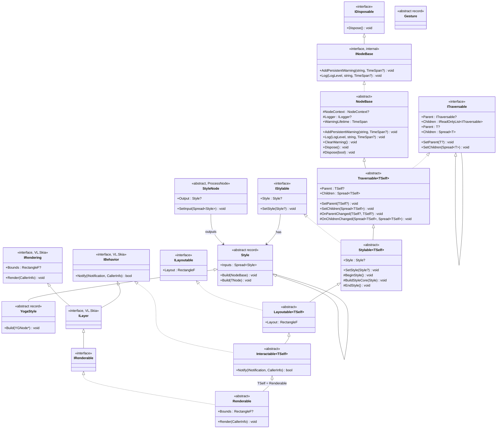

# `Fu.Core` Inheritance Chain & Architectural Summary

## 1. Current Inheritance Chain

`Fu.Core` uses a **Curiously Recurring Template Pattern (CRTP)** (`TSelf`) layered inheritance hierarchy rooted in `NodeBase` and `Traversable<TSelf>`, and closed at `Renderable` (`Renderable : Interactable<Renderable>`). This gives every layer strongly-typed `Parent` and `Spread<Renderable> Children` without casting, while still exposing non-generic interfaces (`ITraversable`, `IStylable`, `ILayoutable`, `IBehavior`, `IRenderable`) for untyped inspection and VL patching.

### Mermaid Class Diagram



### Linear Chain Summary

```text
NodeBase (INodeBase : IDisposable)                           [Fu.Core.Base]
  └── Traversable<TSelf> (ITraversable<TSelf> : ITraversable) [Fu.Core.Tree]
        └── Stylable<TSelf> (IStylable)                       [Fu.Core.Styling]
              └── Layoutable<TSelf> (ILayoutable)             [Fu.Core.Layout]
                    └── Interactable<TSelf> (VL.Skia.IBehavior) [Fu.Core.Interaction]
                          └── Renderable (IRenderable : ILayer) [Fu.Core.Rendering] (closes TSelf = Renderable)
```

**Supporting / Standalone Types:**
* `TraversableExtensions` (`Fu.Core.Tree`) — `Root()`, `Ancestors()`, `Descendants()`, `IsAncestorOf()`
* `Style`, `Style<TNode>`, `YogaStyle` (immutable records) and `StyleNode` process nodes (`Fu.Core.Styling`), see [proposal-style-instructions.md](../proposals/proposal-style-instructions.md)
* `Gesture` (`abstract record` in `Fu.Core.Interaction`)

---

## 2. What Is Already Solved by the Current Base Layers

### A. `NodeBase` (`Fu.Core.Base`)
* **VL Node Diagnostics & Lifecycle:** Accepts hidden `NodeContext`, exposes `ILogger`, and manages visual node warnings directly in the vvvv patch (`AddPersistentWarning`, `Log`, `ClearWarning`) with automatic deduplication and async expiration timers (`DefaultWarningLifetime = 10s`).
* **Resource Management:** Implements `IDisposable` with virtual `Dispose(bool disposing)` so derived layers (like Yoga native handles in `Layoutable` or Skia resources in `Renderable`) have a standard cleanup hook.

### B. `Traversable<TSelf>` (`Fu.Core.Tree`)
* **Dual Generic + Non-Generic Contract:**
  * `ITraversable<TSelf>` exposes `TSelf? Parent` and `Spread<TSelf> Children` (zero-copy VL `Spread<T>` support).
  * `ITraversable` exposes read-only untyped `ITraversable? Parent` and `IReadOnlyList<ITraversable> Children`.
* **Self-Healing Tree Integrity:**
  * `SetChildren` and `SetParent` keep bidirectional parent/child pointers strictly synchronized.
  * `Sanitize` filters out `null` children, duplicate references, self-cycles, and ancestor cycles—reporting patch wiring mistakes via `NodeBase.Log(LogLevel.Warning, ...)` instead of crashing the VL runtime.
* **Lifecycle Hooks for Subclasses:**
  * `OnParentChanged(TSelf? oldParent, TSelf? newParent)` and `OnChildrenChanged(Spread<TSelf> oldChildren, Spread<TSelf> newChildren)` allow `Layoutable<TSelf>` to attach/detach `YGNode` children automatically when the tree changes.
* **Allocation-Friendly Traversal:**
  * `TraversableExtensions` provides `Root()`, `Ancestors()`, `IsAncestorOf()`, and an iterative stack-based pre-order `Descendants()`.

---

## 3. Remaining Semantic & Architectural Questions (Next Layers)

With `NodeBase` and `Traversable<TSelf>` in place and `Interactable<TSelf>` renamed, the remaining design decisions focus on how data flows down and up the `Stylable -> Layoutable -> Interactable -> Renderable` layers:

### A. Styling Semantics (`Style` & `Stylable<TSelf>`)
Resolved and implemented as immutable style instructions, see [proposal-style-instructions.md](../proposals/proposal-style-instructions.md). Still open:
* **State-Driven Styling (Pseudo-states):**
  * Visual and layout styles often depend on interaction state (`Hovered`, `Pressed`, `Focused`, `Disabled`) which lives lower in `Interactable<TSelf>`.
  * Either `Stylable<TSelf>` exposes a style sheet/rule that gets evaluated with the current interaction state during the update/render pass, or `Interactable<TSelf>` notifies `Stylable<TSelf>` when pseudo-states change.

### B. Yoga Layout Lifecycle (`Layoutable<TSelf>`)
`ILayoutable` currently exposes `RectangleF Layout { get; }`.
* **Hook into `Traversable<TSelf>`:**
  * `Layoutable<TSelf>` can own a `YGNode` (disposed via `Dispose(bool)`), and override `OnChildrenChanged` to sync its `YGNode` child list with `Children`.
* **Coordinate Space:**
  * Yoga computes node `Left` and `Top` **relative to the parent**.
  * Hit-testing (`Interactable`) and culling/bounds (`Renderable.Bounds`) often need **global/canvas bounds** (or local-to-parent transform matrices). Clarifying whether `Layout` is parent-relative or root/canvas-relative (or providing both `LocalLayout` and `GlobalLayout`) will avoid confusion later.
* **Custom Measure (`MeasureFunc`):**
  * Leaf elements (text, icons, intrinsic images) need to measure their content via Skia before Yoga computes layout.

### C. Interaction, Hit-Testing, and `Gesture` (`Interactable<TSelf>`)
`Interactable<TSelf>` implements `VL.Skia.IBehavior` (`bool Notify(INotification, CallerInfo)`).
* **Routing Notifications Through `Children`:**
  * In `Notify`, notifications should normally be routed to `Children` in **reverse paint order** (front-to-back, i.e., `for (int i = Children.Count - 1; i >= 0; i--)`), stopping when a child returns `true` (handled).
* **Hit-Testing & Pointer Capture:**
  * Pointer notifications (`MouseNotification`, `TouchNotification`) need a `HitTest(Vector2 position)` check against `Layout` (and clipping bounds).
  * Active gestures (like dragging a slider or scrollbar) need **pointer capture** so the element continues receiving move/up notifications even when the cursor leaves its `Layout` rectangle.
* **Bridging `INotification` to `Gesture`:**
  * `Interactable<TSelf>` can translate raw `INotification` events into high-level `Gesture` records (`Hover`, `Click`, `Drag`, `Scroll`, `Focus`) or allow attaching composable gesture recognizers.

### D. Rendering & Bounds (`Renderable`)
* **Default Tree Rendering:**
  * `Renderable.Render(CallerInfo caller)` can establish the local transform/clip (based on `Layout` and `Style`), call a virtual `RenderSelf(CallerInfo caller)`, and then iterate `Children` in forward order (`foreach (var child in Children) child.Render(caller)`).
* **`Layout` vs. `Bounds`:**
  * `Bounds` (`VL.Skia.IRendering.Bounds`) can default to `Layout` (or union with children/drop-shadows if unclipped).

